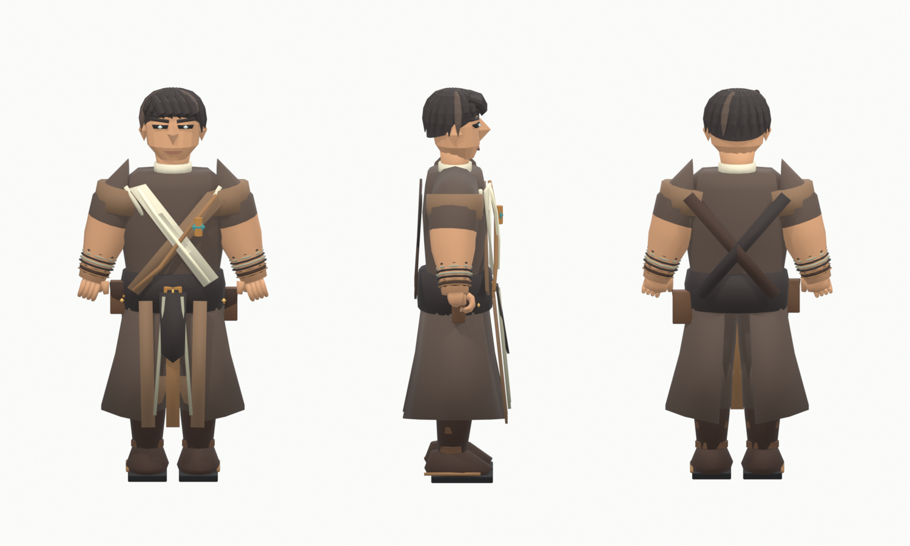

# Эхо · улучшенный Earthbound Monk v29

Основа — собственная модель Эхо из `ERA_Character_Workshop-v19.blend`, коллекция Earthbound Monk. Сохранены короткие волосы, перекрёстные лацканы, обмотки, пояс, подсумки и разрезанная нижняя одежда. Лицо и волосы получили более ясные крупные плоскости; уменьшена голова, выровнен край мантии, добавлены ворот, слои плеч, отделка лацканов, поясная накладка, ранты обуви и небольшой нефритовый грозовой зажим. Палитра состоит из тёмной кожи, коричневой ткани, льняной отделки и сдержанной латуни.

Это отдельный редактируемый `Echo_Refined.blend` и FBX. Исходная мастерская, модель Люмена, эталон лучника и банк анимаций не перезаписываются. Rest matrices, список костей и bind positions Эхо совпадают с v19. В игре сохранены его существующие клипы KayKit и `HumanRigShape`, включая приседание и хват.

В игровом меше **7524 треугольника**, 22 572 вершины после развёртки граней и 121 именованная деталь. Отдельная короткая палочка имеет длину 0,65 м: тёмная древесина, обмотка, латунная обойма и грозовой кристалл. Редактируемые детали палочки сохранены скрытыми в Blender; соответствующий игровой меш строит `EchoWandBuilder`. Одноручный профиль привязывает её к правой ладони; левая рука свободна. Палочка отображает прежнее оружие LightningStaff, его урон, молнии и пассивка Эхо сохраняются.

Повторение: `blender --background --threads 2 --python-exit-code 3 --python ArtSource/Characters/Echo/ReleaseV29/refine_echo.py` из корня проекта. Скрипт загружает v19, сохраняет отдельные исходники и JSON, сравнивает rest skeleton и bind positions и проверяет контрольную сумму исходной мастерской. [Отчёт экспорта](validation.json). Реальная деформация, все комбинации оружия и захват проверяются отдельно в Unity Player; [итоговый отчёт](../../../../Docs/VALIDATION-v0.29.md).
