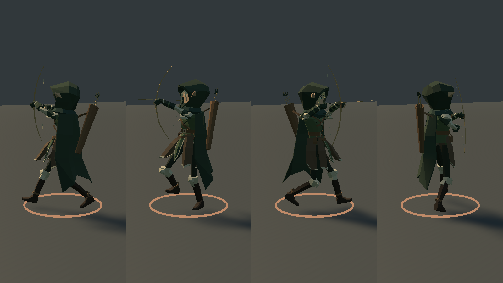
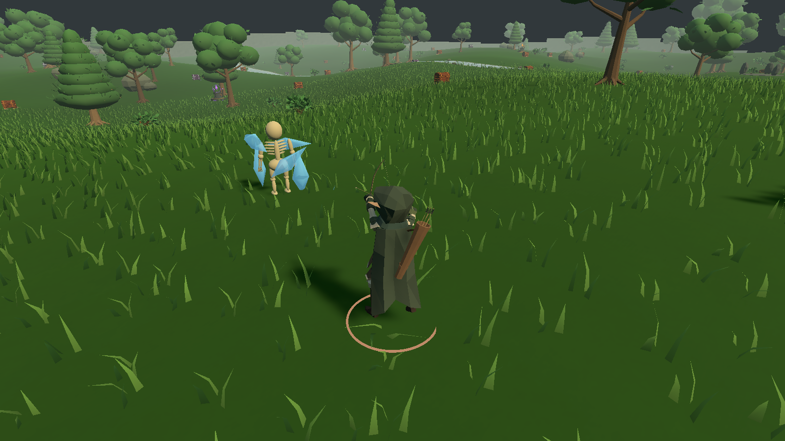

# Лучник: движение, стрельба и вторичная анимация

27 октября 2026. Эти изменения входят в [Windows-релиз v0.22.0](https://github.com/Regardov/Era/releases/tag/v0.22.0). Основа — `512224f27ff7dce3c40acef600a0387a5809e075`, содержащая обновления Regardov; интеграция анимаций — `4b84ca0841881256dddbd71fb798ac3bd61499af`. Внешность не переделана: 23 skinned mesh, 3929 треугольников, 54 кости, прежние веса и 19 материалов. [Проверка версии 0.22.0 и готовой сборки](VALIDATION-v0.22.md).

## Root Cause

Override-слой стрельбы включал Spine, Chest, плащ и QuiverAttach. Постоянные ключи BowHold подавляли движение нижнего слоя. Аудит до исправления: Spine Run ≈2°, Run+Hold 0°; Cape2.C ≈9.34° → 0°. Clavicle.L/R не имели движения даже в исходном Run. Конфликта с Animation Rigging не обнаружено: пакет/constraints не использовались. [До](archer-motion-layers-before.json) · [После маски](archer-motion-layers-after.json).

## Locomotion Improvements

В существующий Run добавлены перенос таза на 7 мм, небольшие вращения таза, противодвижение позвоночника/груди, движение ключиц и компенсация головы. Ноги решены к прежним мировым целям голеностопов; геометрия и rest pose не менялись. Остальные 15 исходных Actions и их Unity-клипы сохранены. Из Walk/Run получены шесть вариантов Left/Right/Back: это производные существующего движения, не покупные и не заново смоделированные ассеты. Всего 22 клипа.

Base Layer использует 2D directional Blend Tree: Idle и восемь Walk/Run. Параметры MoveX/MoveZ берутся из реальной локальной скорости; частота адаптируется к скорости игры. За пределами авторского диапазона параметры направления ограничены, чтобы быстрый strafe не вытеснялся одним forward-клипом. [Сохранность исходников](archer-motion-source.json) · [GUID/материалы/15 клипов](archer-motion-preservation.json).

## Run + Shoot

Маска начинается от Chest; Spine, ноги, плащ и QuiverAttach оставлены базовому слою. Chest/руки сохраняют авторскую последовательность Aim → Draw → Hold → Release → Recovery. После Animator один `ArcherMotionRig` добавляет компенсацию груди/ключиц и решает IK рук. Обе цели рук корректируются вместе в доступную область досягаемости; взаимное положение хвата и хвостовика не растягивается двумя независимыми ограничениями. Линия рук немного опущена от края капюшона; часть контактов всё ещё остаётся.

Run+Aim в измеренном Player: Spine 3.99°, Chest 7.69°, Clavicle.L 2.96°, Cape2.C 8.03°. Максимальная остаточная ошибка решения кистей во всех трёх прогонах 0.01 мм. Это ошибка до намеченных целей IK, не отдельная метрическая гарантия контакта пальцев с тетивой.

При продолжении стрельбы используется начальный участок Recovery и возврат к Draw без полного опускания лука. Авторитетные снаряды/урон и `ArcherShotProfile` не менялись; root motion остаётся выключенным. Release-события по-прежнему защищены от дублей.

## Turning

Визуальное тело доворачивается до 360°/с, комфортный twist 55°, верхний предел 70°. Поворот распределяется между тазом, Spine и Chest; добавляется ограниченный наклон в сторону поворота. Голова компенсирует движение корпуса. Голеностопы удерживают авторские цели при наклоне таза. `PlayerState`, коллизии и управление Simulation не перестроены; другие герои используют прежнюю ветку ArenaView.

## Cloak

Используются существующие шесть костей плаща: три двухзвенные цепи. Аналитическая критически затухающая пружина 2.5 Hz учитывает скорость, ускорение, торможение и поворот. Нижние сегменты реагируют сильнее верхних; стороны имеют сдвиг фазы. Вектор добавочной пружины ограничен 12°, это не предел суммарного угла исходной анимации и всех добавок. Перед следующим Animator-проходом добавки восстанавливаются, поэтому не накапливаются. На паузе поза сохраняется. Cloth/новые библиотеки не добавлены.

## Quiver

QuiverAttach остаётся дочерней костью Chest; меш колчана и все пять стрел следуют этой кости. Небольшая пружина 5.5 Hz ограничена 3°, локальная позиция крепления не изменяется. Максимальный измеренный дрейф крепления 0.0009 мм; остаток после остановки практически нулевой.

## Tests

Unity 2023.1.22f1: компиляция, 22758 проверок проекта и Windows x64 Build прошли. Дополнительный аудит движения: 248 проверок; остаток опорной траектории за 0.09 с не более 22.54 мм, включая авторский перекат стопы. Это выборочная проверка чистых клипов, не гарантия отсутствия foot sliding на любом склоне/диагональном переходе. Ошибка аналитической пружины при равном времени 15/30/60 FPS: 4.77e-07.

Реальный игровой экземпляр, обычный Animator, без SampleClip/ручного Animator.Update: Idle, Walk, разгон, Run, Run+Aim, Run+Fire, 90°, 180°, Turn+Fire, strafe в обе стороны, назад, торможение, покой, вызов существующего DodgeRoll API, возврат к бегу.

| Ограничение FPS | Измеренный средний FPS | Сценариев | Выстрелы / события | Результат |
|---:|---:|---:|---:|---|
| 15 | 14.51 | 16 | 8 / 8 | PASS |
| 30 | 29.50 | 16 | 8 / 8 | PASS |
| 60 | 58.25 | 16 | 8 / 8 | PASS |

FPS измерен в диагностическом режиме с упрощёнными настройками, не является обещанием производительности полной игры. [15 FPS](archer-motion-15fps.json) · [30 FPS](archer-motion-30fps.json) · [60 FPS](archer-motion-60fps.json) · [Editor](archer-motion-editor.json).

Дополнительный runtime-тест: 6 выстрелов / 6 событий, 0 пропусков release-позы; проверены обычный автовыстрел и Cast+AutoFire, черновая Death включалась только тестом. Echo/Lumen сохранили движение ходьбы/бега. Семь моделей и присед проверены, риги — 108 поз, шесть оружий. Регрессии анимаций/эффектов с 90 врагами прошли, включая паузу и очистку. [Основной Player-тест](archer-motion-core-runtime.json) · [Остальные персонажи и эффекты](archer-motion-regressions.json).

В 63 экспортированных комбинированных позах BVH не нашёл пересечений лука с телом/капюшоном/одеждой/плащом/ногами, колчана с плащом и колчана с плечевой бронёй. Масштаб при BakeMesh компенсирован до перевода в пространство персонажа, согласно [Unity API](https://docs.unity3d.com/2023.1/Documentation/ScriptReference/SkinnedMeshRenderer.BakeMesh.html); проверка не использует повторно увеличенные меши. Найденные контакты перечислены, а не скрыты: [полный аудит поверхностей](archer-motion-contacts.json). Проверки после последних правок выполнены в Player; это не только наличие FBX.

Воспроизведение: `Tools/Build.ps1`, `Tools/Test-ArcherMotion.ps1 -Fps 30` (также 15 и 60), `Tools/Test-Archer.ps1`, `Tools/Test-Characters.ps1`, `Tools/Test-Rig.ps1`, `Tools/Test-Animation.ps1`, `Tools/Test-Feedback.ps1`. Аудит поверхностей: Blender `--background --factory-startup --python Tools/Audit-ArcherContacts.py` после прогона 30 FPS. Артефакты в `Artifacts/`, без изменения открытой Blender-сцены.

## GitHub

Существующий репозиторий `Regardov/Era`, ветка `main`; исходные изменения Regardov сохранены. Подтверждён аккаунт публикации ZXCJORA / имя -eshka, локальный noreply email соответствует ID 184305811. Коммит и успешный push проверяются отдельно при публикации. Старую историю/авторство не переписываем. Исходный v0.21 доступен в предыдущем коммите и проверенных локальных backup .blend/FBX. [Редактируемый Blender-файл](../ArtSource/Characters/Archer/Archer_Animated.blend).

## Remaining Issues

- Полной очистки clipping нет. При некоторых прицельных позах правый рукав касается капюшона; плащ касается ноги при обратном ходе/резком развороте и в черновом перекате. Приблизительная максимальная глубина внутренних выборочных точек 34.2 мм; это оценка для оболочек, а не точное решение коллизий. Шарф/наплечники и ремни/плащ также пересекаются, в том числе в местах крепления; их полная очистка не выполнена. Нужна отдельная локальная доработка этих контактов.
- DodgeRoll и полноценная Death остаются художественными черновиками; они не пересоздавались в этом задании. В игре Death по умолчанию по-прежнему заменена пиковой Hit-позой.
- Нет вертикального aim, terrain-aware foot IK и гарантии идеального контакта стоп на всех склонах. Диагональные переходы и очень высокая скорость требуют более длительного ручного playtest.
- Проверено автоматическими сценариями и визуально по последовательностям кадров, не длительным ручным прохождением/сетевым сеансом на нескольких ПК. Мгновенная смена цели за спину точно в кадр release отдельно не проверена. Все возможные смешивания и устройства не проверены.
- Движение корпуса и оборудования подтверждено в игре; это не заявление о завершённом качестве всего анимационного комплекта.
