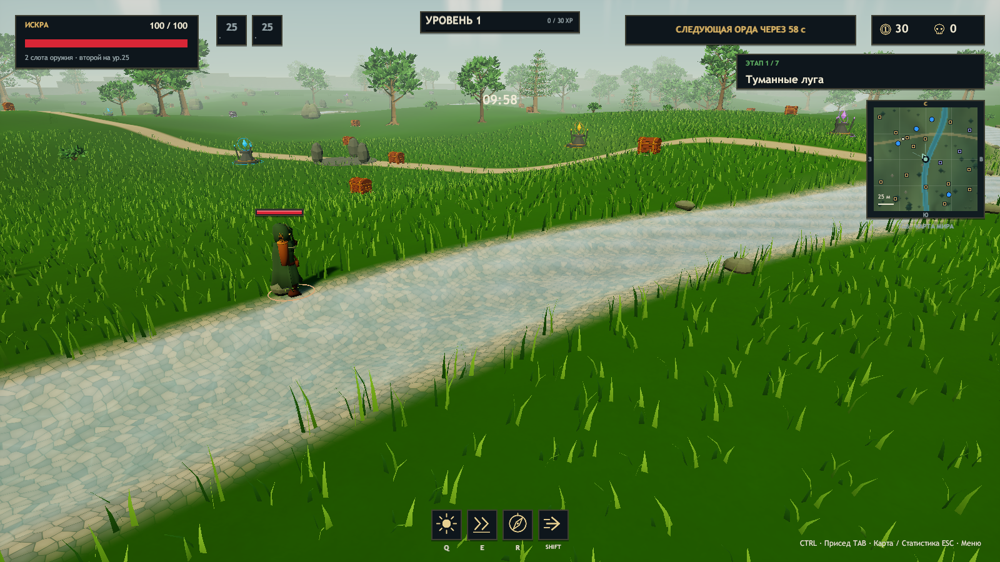
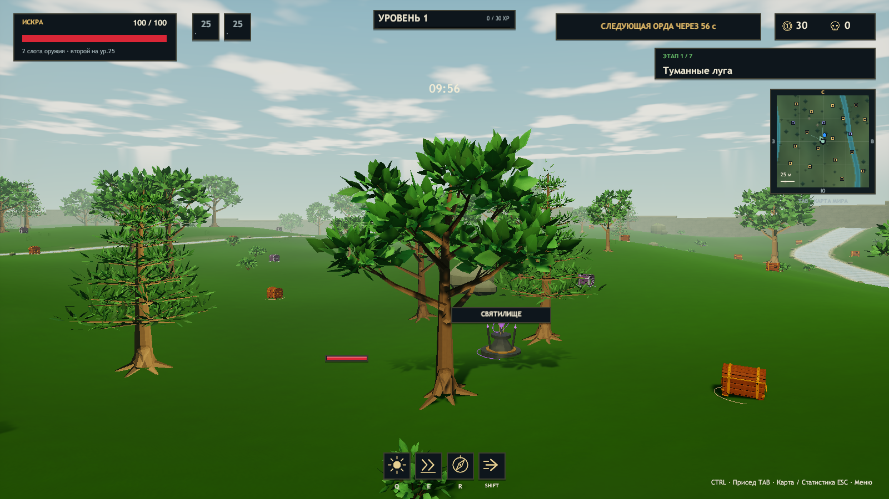
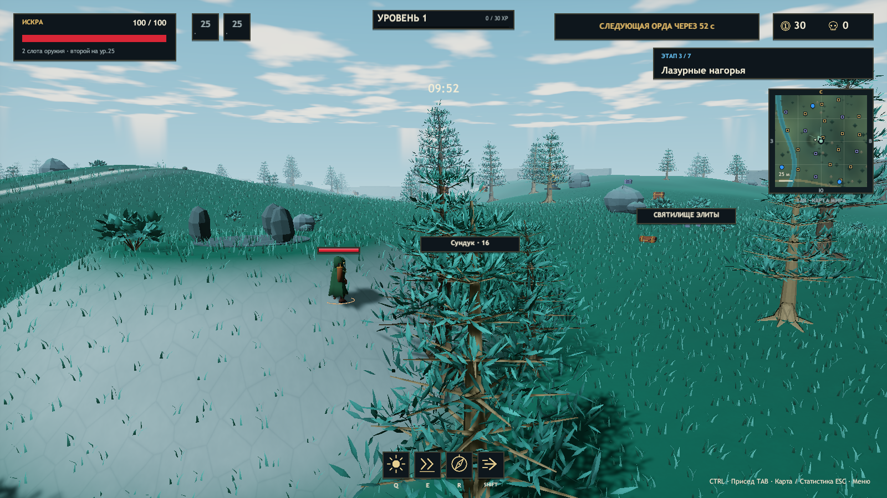
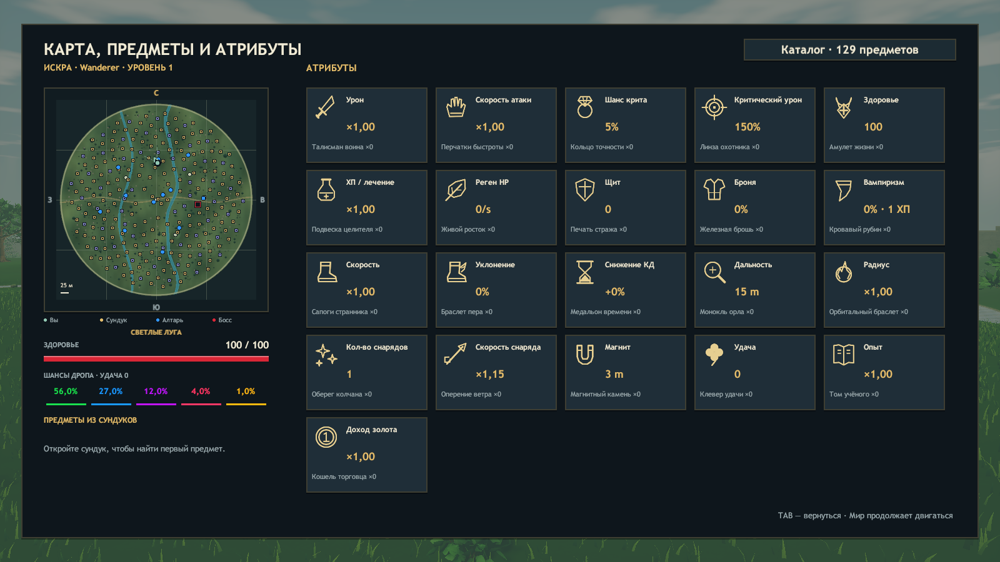

# Вода, деревья и квадратная карта · 25 октября 2026

Доработка текущих исходников ERA поверх v0.19. Unity 2023.1.22f1, Built-in Render Pipeline. Новая локальная Windows-сборка находится в `Builds/Windows/Era.exe`; ссылка на опубликованный архив в README относится к релизу v0.19.

## Вода

Оба водных шейдера используют прозрачную очередь, отключённую запись глубины и общий `ClearWater.cginc`. Сквозь воду виден галечный рисунок дна; оттенок зависит от глубины, по поверхности движется мелкая рябь. Преломление использует общий именованный GrabPass, отражение неба меняется от угла зрения, на мелководье появляются разорванные полосы пены. Проверка глубины подавляет искажение объектов перед водой. Камера запрашивает Depth и DepthNormals. Шейдеры явно включены в Windows Player.

Геометрия и проходимость двух ручьёв сохранены. Дно и карта используют те же центры и ширины русла, что `WorldMap`; галечная фактура и световые узоры рисуются материалом рельефа.

## Деревья

Стволы состоят из шести сужающихся сегментов, имеют наклон, корни, основные ветви и тонкие развилки. Лиственные кроны собраны из отдельных изогнутых листьев с центральным сгибом, прожилками и разными оттенками. Хвойные деревья имеют семь ярусов радиальных ветвей и узкую хвою; в третьем и шестом мирах используются хвойные кроны. Кусты также состоят из веточек и листьев.

Листва двусторонняя, отбрасывает тени и движется от общего ветра с мелким колебанием кончиков. Деревья и кусты объединены в пространственные блоки: отдельных GameObject на каждый лист нет. Сохранены детерминированные позиции и коллизии деревьев. Первая карта пересохранена в сцене с версией окружения 20; остальные миры строятся тем же генератором.

## Миникарта

Во время игры справа видна квадратная карта участка шириной 164 м. Она следует за игроком и сохраняет север сверху. Стрелка и сектор обозначают направление камеры. У края мира окно ограничивается границами карты, маркеры остаются внутри рамки.

Tab показывает квадратную рамку карты всего мира. Круглая каменная стена обозначает реальную форму игровой арены. Подложка содержит высоты, контуры рельефа, тропу, оба ручья, деревья и камни. Она создаётся один раз при смене мира; динамические обозначения обновляются отдельно. Отдельная камера рендеринга карты не используется.

Золотые квадраты — обычные сундуки, сиреневые — лунные; синие точки — святилища; красный квадрат — статуя или босс, красные точки — враги. Игрок обозначен мятным цветом, союзники — сиреневым, упавшие участники — красным. Открытые сундуки и использованные святилища исчезают с карты; активный портал получает кольцо. Есть стороны света, масштаб и легенда.

## Проверки

Финальная сборка: `ERA_CHECKS_OK 2654 assertions`, `Build Finished, Result: Success.`, `ERA_BUILD_OK 514034297 bytes`. SHA256 `Era_Data/Managed/Assembly-CSharp.dll`: `9a6fc5c3e3d1cebb890684c22631c930ec2cf3d5cfc69a8ff6661f0241631571`.

| Проверка | Результат |
| --- | --- |
| `Tools/Test-Environment.ps1` | PASS: прозрачная очередь и поддержка водного шейдера, глубина камеры, геометрия листвы, координаты карты, смена мира, 32 участка ручьёв, 714 объектов отрисовки |
| `Tools/Test-Meadow.ps1` | PASS: 120 иконок, ручьи, кусты, старые деревья, трава, множитель команды ×4, орда после босса, рост сложности и сброс при переходе |
| `Tools/Test-Solo.ps1` | PASS: пауза и продолжение, характеристики, редкость лута, предметы и оружие |
| `Tools/Test-Art.ps1` | PASS: модели, святилище, присед, дополнительный прыжок, описания и кристаллы |
| `Tools/Test-Update.ps1` | PASS: волны, статуя, пять элитных противников, бесплатный сундук, 72 ресурса, отдача, модели и музыка |
| `Tools/Test-Campaign.ps1` | PASS: семь миров, семь боссов, шесть порталов, прыжок, трава, Люмен, сохранение экипировки и шейдеры |

Все сценарии выполнены на финальной сборке. В журналах Player нет ошибок шейдеров, исключений и записей ERROR. [Отчёт окружения](environment-smoke.json) и [сводка сценариев](environment-regression.json) сохранены рядом с документом.

Вручную просмотрены снимки из реального Windows Player: два ракурса ручья, лиственные и хвойные деревья, большая квадратная карта первого и третьего миров. После первого просмотра уменьшена яркость световых узоров и добавлена различимая галька; окончательные снимки и сценарии получены после пересборки.

Проверки запускались скрытым окном с автоматическим ограничением 20 FPS. Они не подтверждают 60 FPS на слабом ПК, длительный ручной забег или игру на разных физических компьютерах. Сетевой протокол и игровые формулы не менялись; отдельный сетевой сценарий в рамках этой доработки не запускался. После проверок изменены только документация и пробелы сериализованной сцены.
