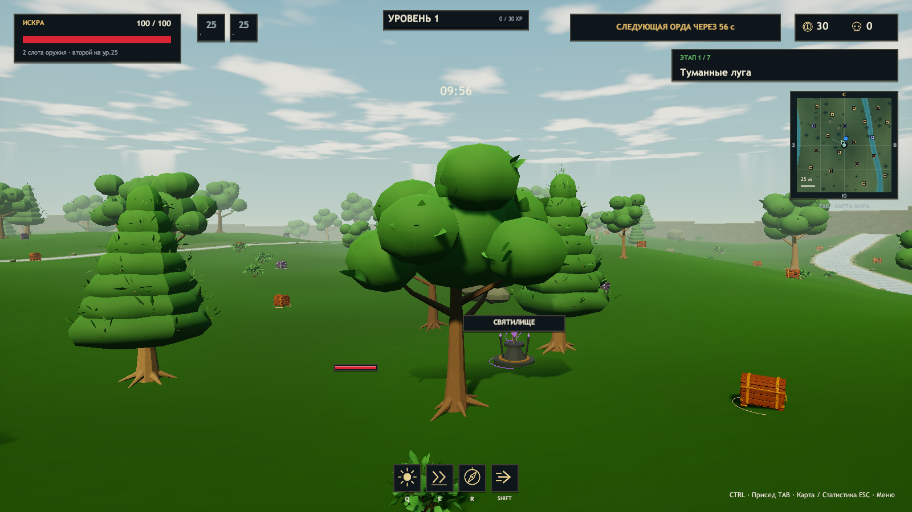
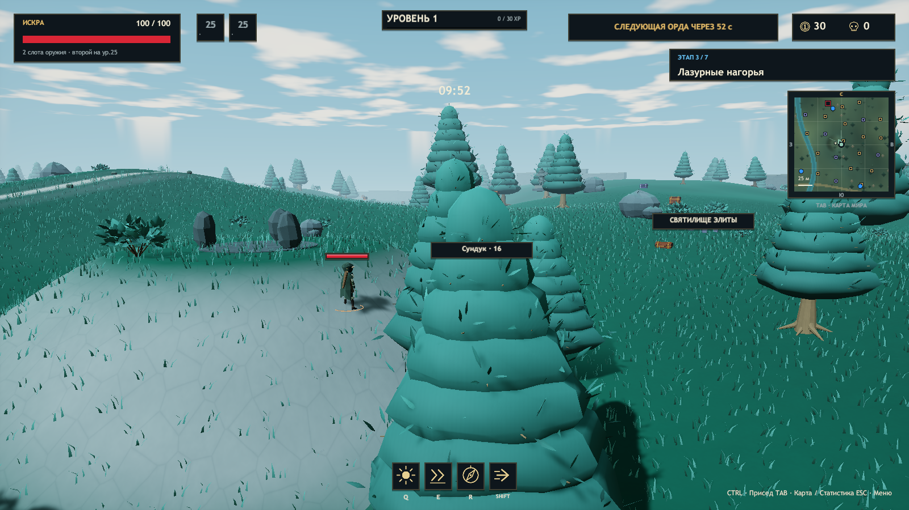
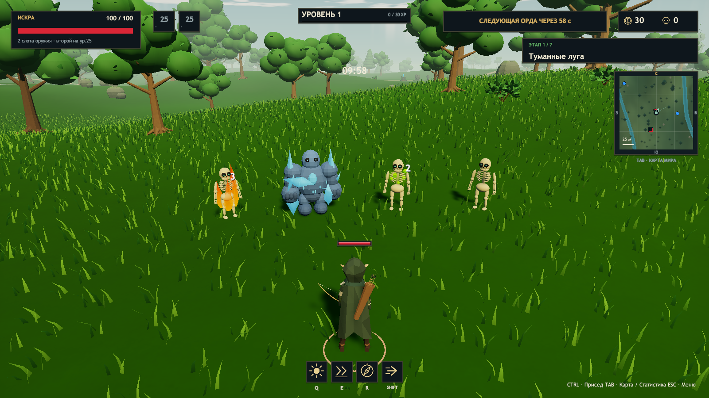
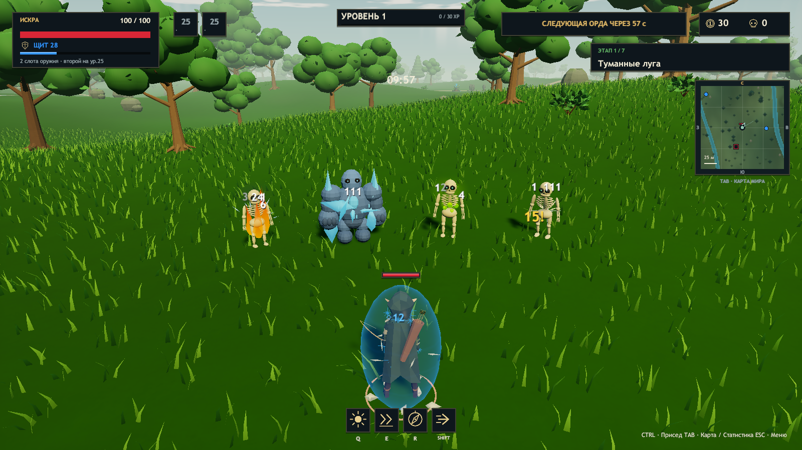
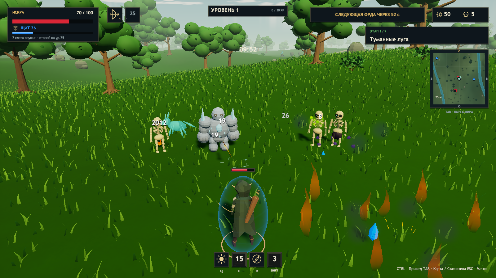

# ERA v0.20: итоговая проверка, 26.10.2026

Unity 2023.1.22f1, Windows x64. `ERA_CHECKS_OK 20896 assertions`, `Build Finished, Result: Success.`, `ERA_BUILD_OK 452472045 bytes`. SHA256 протестированной `Era_Data/Managed/Assembly-CSharp.dll`: `4190f6a916e839764c76c250d758f6fc6af4e51f58b3784ae97d6ac3b951da00`.

Сохранён новый лучник из удалённого коммита `44e4d3f676ff5e213ad46ed73962c13cd7a9cfd9`: модель, 16 Generic-клипов, контроллер, события, присед и детерминированная точка вылета стрелы. Его обработчик анимационного события сохраняет callbacks и счётчики; повторный универсальный выброс частиц удалён, поскольку настоящие Q/E/R уже создают соответствующий эффект симуляции. История Git не переписывалась.

## Что проверено

Редакторские проверки включают все 129 записей реестра, связь статусов с их настоящей механикой, реакцию пара/эхо/корней, иммунитет боссов, фактическое поглощение урона щитом, настоящий крит, JSON-снимки, закрытую геометрию стволов и крон, направление граней, бюджет деревьев, столкновения и проверки импортированного лучника. У обычного прыжка сохраняется горизонтальный запрет перепрыгивания; ниже высоко летящего тела сохраняется естественный свободный проход. Головы врагов никогда не дают опору.

| Сценарий Windows Player | Результат |
| --- | --- |
| Feedback | PASS: статусы, крит, щит, лечение, ускорение, настоящие префабы; 90 врагов; пик 426 частиц / 48 слотов / 16 звуковых голосов; очистка без остатка |
| Environment | PASS Environment: transparentWater=True, depth=True, foliage=True, map=True, realmChange=True, streams=32, renderers=714 |
| Animation | PASS Animation: enemies=90, projectiles=384, effects=320, pool=48, cleanup=True, paused=True |
| Roguelike | PASS Roguelike: items=129, newModels=12, catalogue=True, tooltip=True, combat=True, fps=19.5019569396973 |
| Balance | PASS Balance: menuCatalogue=True, crouch=True, shield=True, evade=True, tooltip=True, chests=240 |
| Art | PASS Models=True, shrine=True, crouch=True, extraJump=True, descriptions=True, crystals=True |
| Solo | PASS Solo: paused=True, resumed=True, attributes=True, rarityLoot=True, items=3, weapons=1 |
| Update | PASS Update: waves=True, statue=True, elites=5, freeChest=True, resources=72, slide=True, humans=True, music=True |
| Campaign | PASS Campaign: realms=7, bosses=7, portals=6, jump=True, grass=True, skeletalLumen=True |
| Music | PASS Music: menu=True, realms=7, streaming=True, transitions=True, pause=True, mute=True, loop=True, return=True, rapid=True, sources=3 |
| Rig | PASS Rig: samples=108, primaryError=2.38418579101562E-07, secondaryError=0.000335723714670166, colliders=True |
| Characters | PASS Characters: models=7, skins=True, clips=True, crouch=True |
| Coop | PASS smoke-host.json : players=3, ready=True, jump=True, chests=1, gold=129, music=True; PASS smoke-client.json : players=3, ready=True, jump=True, chests=1, gold=129, music=True; PASS smoke-client2.json : players=3, ready=True, jump=True, chests=1, gold=129, music=True |

Звук записывался через AudioListener при отключённой музыке: максимальный RMS `0.030716`, воспроизведено 210 сигналов. Искусственная перегрузка подавила 5895 избыточных запросов. Это проверка ограничителей, а не число потерянных обычных игровых действий.

[Метаданные сборки](feedback-build.json) · [Редактор](feedback-editor.json) · [Геометрия и семантика](feedback-checks.json) · [Коллизии](feedback-body-checks.json) · [VFX/SFX](feedback-smoke.json) · [Сценарии](feedback-regression.json) · [Три участника](feedback-coop.json).

Отдельно проверен тёплый цвет огня на 1752 реально испущенных частицах.

## Визуальная проверка

Просмотрены кадры настоящего Windows Player: закрытые стволы и плотные лиственные/хвойные кроны, огонь/иней/яд, прозрачный реактивный щит, лечение, ускорение, предметные механики и нагрузка. После просмотра уменьшены частицы обычных попаданий и подборов; пламя получило отдельную форму и мерцание; у щита исправлена мировая нормаль для прозрачного центра. Иней объединён в один меш на врага.

## Изменённые файлы

Полный перечень, включая материалы, префабы, метаданные и запечённые меши: [feedback-changed-files.txt](feedback-changed-files.txt).

| Подсистема | Основные файлы |
| --- | --- |
| Механики и снимки | GameData.cs, MechanicFeedback.cs, Simulation.cs, Simulation.Items.cs, Simulation.Combat.cs, Simulation.Auras.cs, Simulation.Campaign.cs, Simulation.Enemies.cs |
| VFX | PresentationFx.cs, FeedbackGeometry.cs, StatusPresentation.cs, ItemFieldPresentation.cs, AbilityPresentation.cs, EffectPresentation.cs, HazardPresentation.cs, ArenaView.cs, ArcherAnimationDriver.cs, GameHud.cs |
| SFX | SynthAudio.cs, SynthAudio.Combat.cs |
| Деревья | SceneryBuilder.cs, WorldEnvironment.cs, RealmLeaves.shader, Scenes/Rift.unity и новые Generated/Realm10-chunk-*.asset |
| Ресурсы VFX | Resources/Feedback/CombatParticle.prefab, SmokeParticle.prefab, Particles.mat, Smoke.mat, Shield.mat, Flame.mat; FeedbackSolid.shader, ProtectiveField.shader, LivingFlame.shader; Generated/CombatFeedback-v21.asset |
| Контакты | ActorBodies.cs, Editor/BodyCollisionChecks.cs |
| Проверки и сборка | Editor/MechanicFeedbackChecks.cs, FeedbackPrefabBuilder.cs, BuildTools.cs, SimulationChecks.cs, FeedbackDiagnostics.cs, GameApp.cs, Tools/Test-Feedback.ps1, Package.ps1, Verify-Package.ps1, Publish.ps1, ProjectSettings |

Исходники Blender `ERA_Character_Workshop.blend` с прежними незавершёнными пользовательскими изменениями и отдельный репозиторий Website сохранены вне коммита. Новый импортированный лучник уже входит в базовый удалённый коммит и не откатывался.

## Границы проверки

В графических журналах нет исключений, ошибок шейдеров и загрузки звука. Headless-кооператив использует NullGfxDevice и выдаёт только ожидаемые сообщения о неподдерживаемых шейдерах; прочих ошибок и исключений в трёх сетевых журналах нет.

Сценарии выполнялись скрытыми окнами с автоматическим ограничением 20 FPS; три сетевых процесса запускались на одном компьютере. Проверки подтверждают синхронизацию, ограниченность пулов и отсутствие ошибок сценариев. Они не заменяют длительный ручной забег, оценку баланса, проверку 60 FPS на слабом ПК или сеть между разными физическими компьютерами. После окончательных игровых проверок допускаются только документация и нормализация пробелов сериализованных файлов.

Упаковка дополнительно проверяет все файлы готовой сборки внутри ZIP по длине и SHA256 и сверяет опубликованный файл контрольной суммы. Контрольная сумма архива опубликована отдельным GitHub-asset, чтобы не создавать циклическую зависимость документа и ZIP.
