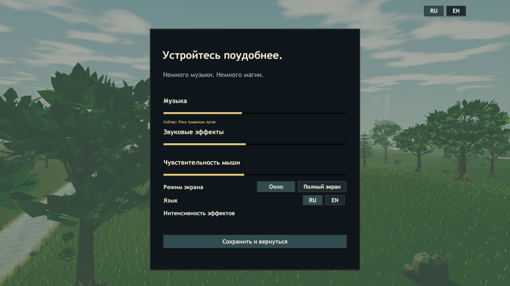

# Музыка меню и семи миров

Восемь отдельных инструментальных композиций заменяют прежние две короткие синтезированные петли. Суммарная длительность — 15:06; полный список треков, MIDI-партитуры, 80-секундное превью и инструкция записи находятся в [ArtSource/Music](../ArtSource/Music/README.md).

`MusicCatalog` сопоставляет меню и каждый мир своему ресурсу. Главное меню, настройки, выбор персонажа и лобби используют «Свет у порога». Начало забега и переход через портал выбирают музыку текущего мира; на экране результата остаётся его композиция с меньшей громкостью. Возвращение в меню возвращает тему меню.

`SynthAudio` воспроизводит музыку через две AudioSource с переходом 2,4 секунды и равной мощностью огибающих. При возврате к исходному треку во время перехода огибающая плавно разворачивается. При нескольких быстрых сменах мира сохраняется последняя запрошенная композиция; она включается после текущего перехода. После затухания старый источник останавливается и освобождает ссылку на клип. Вместе с источником звуковых эффектов на компоненте постоянно остаётся три AudioSource.

Пауза приглушает музыку до 48% и оставляет воспроизведение работающим. Ползунок музыки меняет только музыку и при нуле полностью убирает её из выходного сигнала. В настройках отображается название текущей композиции. Все восемь клипов импортируются как stereo Streaming/Vorbis с quality 0,85, чтобы альбом не распаковывался целиком в оперативную память. В проект включены готовые Ogg-мастера; установленный синтезатор игроку не нужен.

## Проверка

Windows-сборка: `ERA_CHECKS_OK 2679 assertions`, `Build Finished, Result: Success.`, `ERA_BUILD_OK 526340425 bytes`. SHA256 `Era_Data/Managed/Assembly-CSharp.dll`: `48ff9b70ed6d2b106c9ef40ce79c9d71904b38ddbbca98ad31072e7a803c14dd`.

| Проверка | Результат |
| --- | --- |
| `Tools/Test-Music.ps1` | PASS: меню, семь разных тем миров, Streaming, переходы, приглушение и продолжение на паузе, полное mute, переход петли через конец клипа, возврат в меню, быстрые смены миров, три AudioSource |
| `Tools/Test-Update.ps1` | PASS: боевая музыка, события мира, волны, статуя, элиты, ресурсы и настройки |
| `Tools/Test-Campaign.ps1` | PASS: семь миров, семь боссов, шесть порталов и сохранение экипировки |
| `Tools/Test-Solo.ps1` | PASS: пауза и продолжение, характеристики, редкость лута, предметы и оружие |

Сценарий музыки анализирует реальный выход AudioListener при выключенных звуковых эффектах: у всех восьми тем зафиксирован ненулевой сигнал. Он проверяет, что музыкальный таймер продолжает идти на паузе, при нуле ползунка выход становится тихим и петля действительно переходит через конец клипа. [Полный отчёт](music-smoke.json).

Все Ogg-мастера декодированы после записи: stereo 44,1 кГц, 90–131 секунды, пиковый уровень от −5,34 до −3,05 dBFS, RMS от −18,71 до −18,64 dBFS, длинных пауз нет. Перепад первого/последнего семпла — 0,0025–0,0125. Эти измерения не заменяют субъективную оценку аранжировок; для неё приложены полные треки и превью. RMS не обозначает LUFS.

Просмотрен актуальный снимок настроек: строка названия композиции помещается между ползунком музыки и настройкой эффектов.

Проверки выполнены на финальной сборке. После них изменялись только документация и пробелы метаданных Unity. Длительный ручной забег, слуховая оценка на разных акустических системах и отдельная сетевая проверка в этой доработке не выполнялись.
