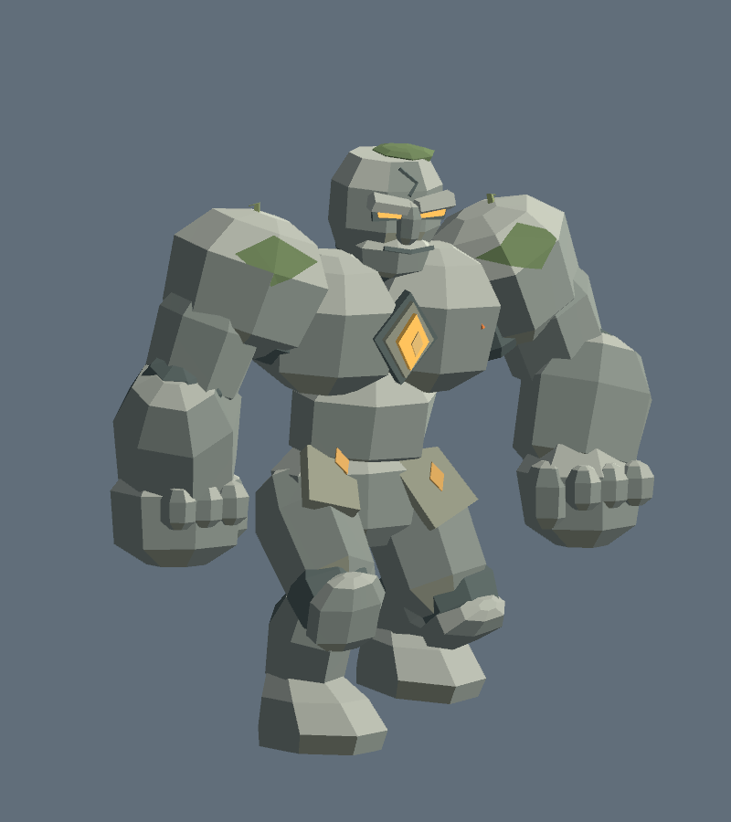
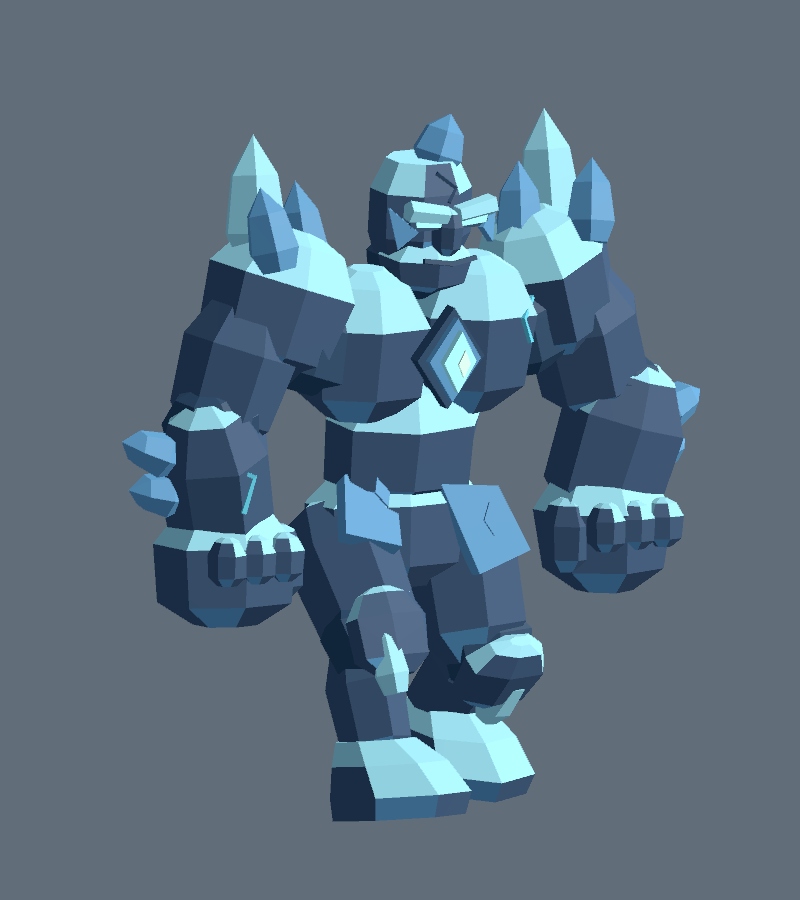
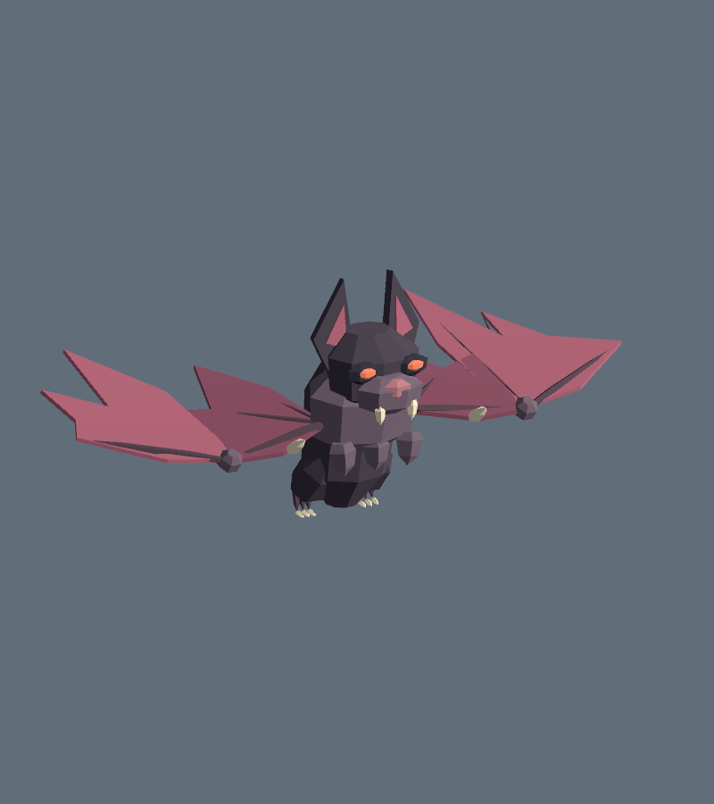

# ERA v0.30.0 — големы и кровавая летучая мышь

[Скачать Windows-игру](https://github.com/Regardov/Era/releases/download/v0.30.0/Era-Windows.zip). Распакуйте архив целиком и запустите `Era.exe`. Unity и Blender не требуются. В кооперативе используйте одинаковую версию 0.30.0.

## Изменения

- **Каменный голем:** сохранена библиотечная модель (2880 треугольников), добавлена выразительная походка: перенос веса, подъём и перекат стоп, работа коленей, наклон/поворот корпуса и противоход рук. Удар обеими руками и его игровой урон сохранены.
- **Кристальный голем:** отдельная производная модель (3208 треугольников) с собственной геометрией плеч, кварцевыми наростами, гранёными предплечьями/голенями и холодной каменно-кристальной палитрой. Использует ту же артикуляцию из 15 шарниров и новую походку.
- **Кровавая летучая мышь:** новая модель (1660 треугольников, 9 шарниров): объёмное тело, большие уши, глаза/клыки, замкнутые перепонки с рёбрами, когти и хвостовая мембрана. Добавлены взмахи, колебание тела и пикирование при атаке.
- Причина слабого движения голема: скорость анимации считалась по дискретной позиции симуляции 30 Гц, поэтому на многих кадрах при высоком FPS была нулевой. Для этих трёх существ используется перемещение уже сглаженной модели за кадр; анимационная фаза идёт по времени и пройденному расстоянию. Расчёт движения остальных врагов сохранён.

В каталоге игры два вида големов — каменный и кристальный, оба охвачены. Горгулья — отдельный летающий враг; её модель не заменялась. Параметры HP, скорости, урона, волн и выпадений не менялись. Сохранены герои, их способности, семь миров, коллизии Иггдрасиля и камера v0.29.2.

## Модели

## Технические ограничения

Движения выполняются `GolemMotion`/`BatMotion` в Unity по иерархии жёстких частей. Это не новый набор FBX-клипов или Humanoid Avatar. Blender Actions для этих моделей не создавались. Тесты охватывают преследование и атаки на выбранной полосе рельефа, а не все возможные склоны; отдельной привязки стоп к каждой неровности земли нет. Поддержка слабых ПК и сетевой игры в этом проходе отдельно не измерялась.

Исходники `.blend`, скрипты построения и снимок анимационного кода сохранены локально в `C:/Users/kolon/Documents/Codex/ERA-Character-Library/Working/Creatures-v030`. В репозитории только нужные игровые меши, prefab, код и проверки. Библиотека персонажей не включена в Windows ZIP.

## Проверки окончательной Windows-сборки

Unity **2023.1.22f1**, Windows x64, чистая сборка (`Tools/Build.ps1 -CleanCache`) завершена успешно. Общие проверки игры: **74 972 assertions**; модели/крайние позы: **20 737**; прежние коллизии/атаки голема: **1875**. Это автоматические проверки с сохранёнными отчётами, а не оценка качества по одному скриншоту.

В настоящем Player через `Tools/Test-CreatureLibrary.ps1` проверены экземпляры врагов: преследование, работа конечностей/крыльев, замах и фактическое уменьшение HP героя. Ошибок Unity — 0. Целевая частота теста 150 FPS; это не гарантированная частота на любом ПК.

| Существо | Треугольники | Пройдено | Движение | Атака / урон |
|---|---:|---:|---|---|
| Каменный голем | 2880 | 4.58 м | PASS | PASS |
| Кристальный голем | 3208 | 6.08 м | PASS | PASS |
| Кровавая мышь | 1660 | 11.04 м | PASS | PASS |

У големов ход стопы по продольной оси около **0,776 м**, рук — **0,438 м**; размах угла крыла мыши — **100,4°** между крайними положениями. На тестовом рельефе максимальное погружение подошвы каменного голема — около **2,2 см**, кристального — **0,2 см**. На плоской поверхности все 64 проверенные фазы шага проходят проверку контакта с допуском 3 мм.

- Семь миров, дерево, LOD, столкновения, свободное небо и наклоны камеры: PASS.
- Кампания: 7 миров, 7 боссов, 6 порталов, прыжок и модель Люмена: PASS.
- Движение лучника и камеры с заданным лимитом 150 FPS: PASS. Проверялась обычная игровая камера; это проверка плавности, а не нагрузочный бенчмарк.
- Player content audit: **626** исходных runtime-ассетов, библиотека Blender отсутствует. Проверка ZIP дополнительно сравнивает контрольные суммы каждого игрового файла.

[Отчёт существ](Creatures-v030/runtime-creatures.json) · [Проверки моделей](Creatures-v030/editor-creatures.json) · [Миры и камера](Creatures-v030/runtime-worlds.json) · [Кампания](Creatures-v030/runtime-campaign.json) · [Плавность 150 FPS](Creatures-v030/runtime-camera.json) · [Содержимое Player](Creatures-v030/player-content.json).

Игровые кадры: [каменный голем](Creatures-v030/StoneGolem-game.png), [кристальный голем](Creatures-v030/CrystalGolem-game.png), [мышь при атаке](Creatures-v030/Bat-game.png).
