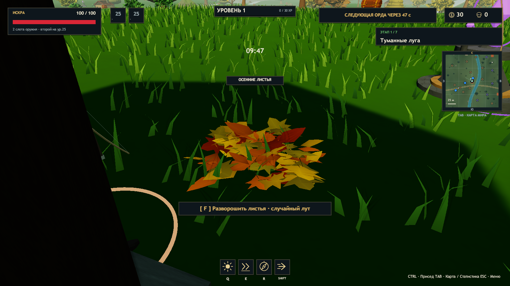
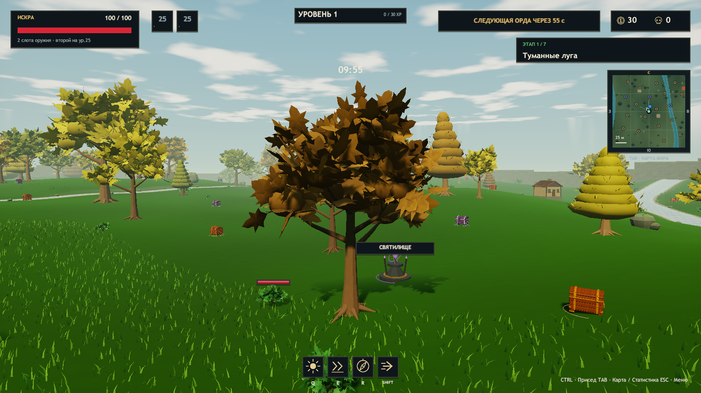
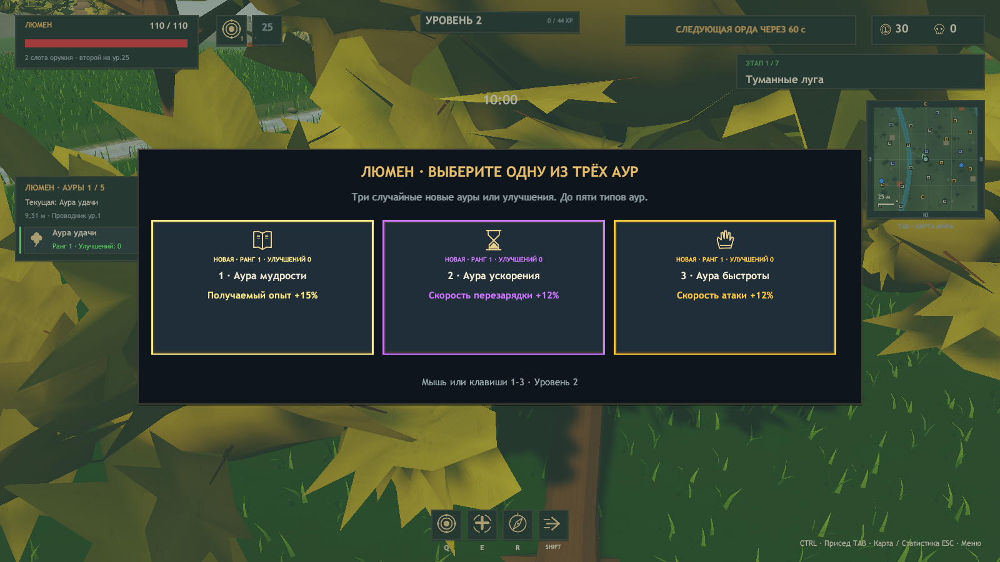
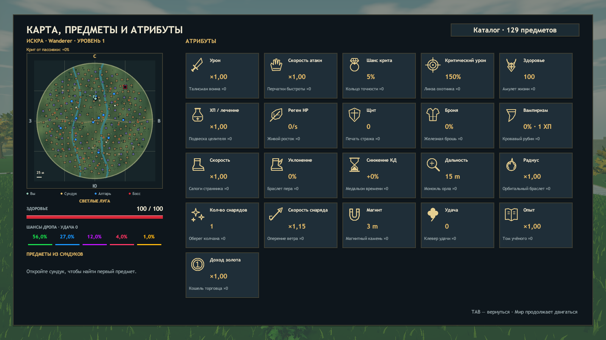

# ERA v0.22 — пассивки, выбор аур и осенний мир

Проверено 27 октября 2026 года, Unity 2023.1.22f1, Windows x64. Ветка: `codex/autumn-passives-auras`.

## Изменения

- Лучник: +3 процентных пункта к шансу крита за каждое повышение уровня.
- Эхо: +10% к рикошету молний оружия за повышение уровня. `230% = 2 гарантированных перехода + 30% шанса третьего`. Гарантированные переходы пассивки складываются с Семенем рикошета; повторные цели исключены, сохраняется прежнее уменьшение урона до 65% за переход.
- Люмен: +3% к радиусу аур за повышение уровня, отдельно от радиусов способностей. После аксессуара — три случайные различные карточки новых аур или улучшений изученных. Сохраняется лимит пяти типов; при достижении лимита предлагаются только улучшения.
- Пассивки начисляются при получении уровня, включая несколько уровней подряд и павших союзников. Выбор аксессуара, ауры или второго оружия не начисляет бонус повторно. На Tab показан накопленный бонус.
- Вместо видеокарт — 72 кучки осенних листьев. Хост определяет золото или опыт с вероятностью 50/50 при разрушении. Меш, цвет, название и реакция на удар не читают вид награды. Одна кучка даёт награду только один раз.
- На всех семи картах — домики и руины. Постройки обходят ручьи и святилища, учитываются при размещении объектов, в общей коллизии и на карте. В первом мире 32 постройки. Деревья получили отдельные резные листья с рёбрами, прожилками и осенними оттенками.
- Протокол 15 передаёт число полученных повышений уровня. Для кооператива всем нужна эта сборка.

Базовые параметры героев сохранены. Постройки декоративные, с твёрдым основанием, без игровых интерьеров.

## Проверки

`Tools/Build.ps1`: `ERA_CHECKS_OK 22266 assertions`, `Build Finished, Result: Success.`, `ERA_BUILD_OK 574596097 bytes`.

Новый `PassiveAutumnChecks` проверяет начисление сразу 25 уровней, точные пороги 100/200/230%, реальные попадания молний, статистику 400 выстрелов с 30% остатком, сложение с предметом, отсутствие пассивки Эхо у другого героя, три случайные карты аур, лимит пяти типов, рубеж второго оружия, сериализацию, оба вида награды у каждого варианта листьев, защиту от повторного сбора и коллизии построек во всех семи мирах.

| Прогон | Результат |
|---|---|
| Environment | PASS: 32 потока ручьёв, прозрачная вода и глубина; листва; карта; смена мира; 726 рендереров; 32 постройки; меш листьев; три ауры |
| Solo | PASS: пауза/продолжение, три аксессуара, лут, предметы и оружие |
| Chests | PASS: цены 12 → 59, модели, крышка, случайные три ауры, улучшение выбранного ранга, снимок состояния |
| Co-op, три отдельных процесса | PASS у хоста и двух клиентов: `ok=true`, `players=3`, `level=26`, `auras=true`, `secondWeapons=true`, `difficulty=true` |
| Art | PASS: модели, святилище, приседание, дополнительный прыжок, описания и кристаллы опыта |
| Update | PASS: волны, статуя босса, пять элитных стражей, бесплатный сундук, 72 кучки листьев, отдача, музыка и стены |
| Campaign | PASS: семь миров, семь боссов, шесть порталов, прыжок, трава, модель Люмена и сохранение билдов |

Полные отчёты и SHA256 игровой сборки C#: [autumn-validation-v022.json](autumn-validation-v022.json). В графических журналах всех этих прогонов не найдено исключений, ошибок шейдеров или загрузки ресурсов. `git diff --check` пройден. Кооператив проверен на одном компьютере тремя процессами.

## Кадры из Windows Player

Кадры просмотрены визуально после захвата через внутриигровую камеру.

## Границы проверки

Автоматические прогоны и просмотр кадров не заменяют длинный ручной забег, оценку баланса на высоких уровнях и LAN-игру на разных физических компьютерах. Эти сценарии не проверялись.

Запуск проверенной игры: `Builds/Windows/Era.exe`. Папку `Builds/Windows` нужно переносить целиком.
