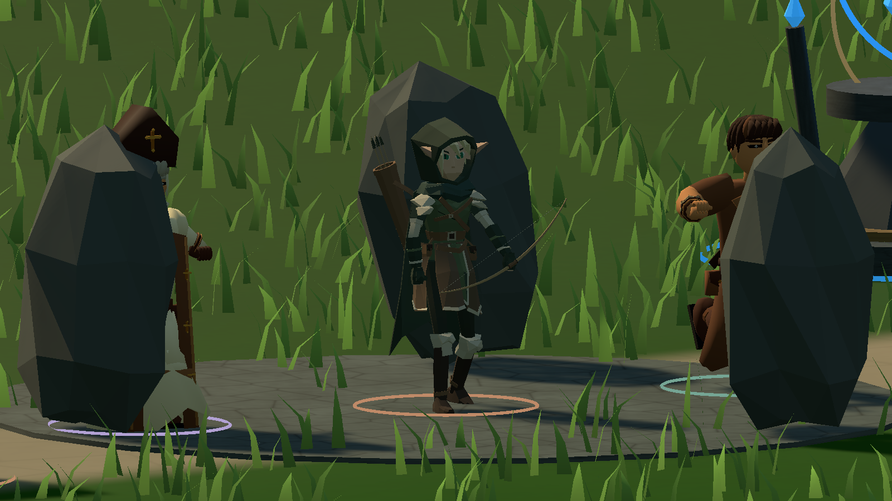
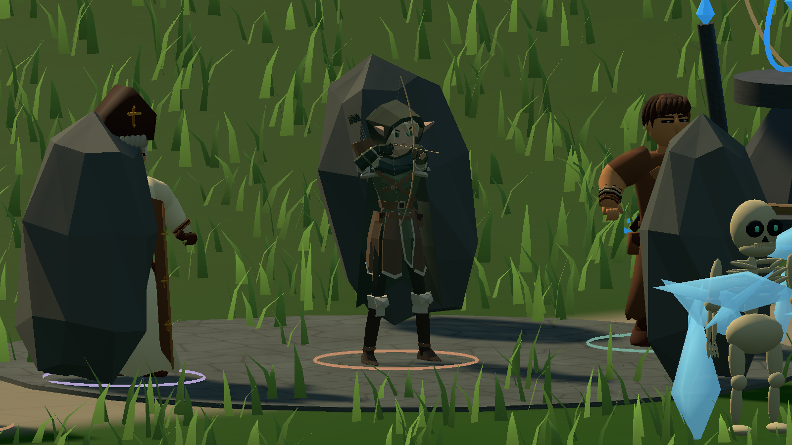
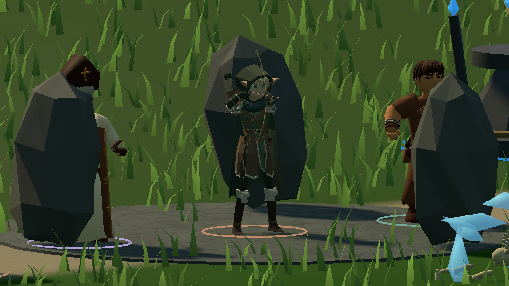

# ERA v0.21 — проверка восстановления анимаций

Основа: `da3c2063f986f9def76f0b786ef675309dbb20e4` (Regardov, v0.20). Unity **2023.1.22f1**, Windows x64, версия Player **0.21.0**. Исходные Blender/FBX не изменены. [Контроль GUID и SHA256](archer-preservation-v021.json).

## Проверки

- Компиляция и Windows Build: PASS, `ERA_CHECKS_OK 20930 assertions`, `ERA_BUILD_OK 456154069 bytes` (размер из BuildReport, не размер ZIP).
- Отдельные проверки лучника в Editor: **2278**, включая native class 74, кривые/события, Avatar, веса, controller, маску, prefab и одновременный cast/fire. [JSON](archer-editor-v021.json).
- Windows Player: `Tools/Test-Archer.ps1`, настоящий экземпляр из `ArenaView`, реальные игровая Simulation и Animator. Тест не вызывает SampleClip, SampleAnimation или Animator.Update. Поза/скорость задаётся тестовым состоянием; движение оценивается после прогрева, а не по одному переходу. [Полный результат](archer-runtime-v021.json).
- Idle: изменение позиции таза **3.39 мм**. Walk: изменение бедра **25.41°**; Run: **39.56°**. Normalized time продвигается.
- **6 игровых выстрелов / 6 deduplicated событий**, 0 без наблюдаемого weighted release-клипа. AutoFire 4/4; CastFire 2/2. После запроса в LateUpdate проверяется следующий фактически оценённый кадр Animator. Есть стрела в Draw и игровые снаряды.
- 23 SkinnedMeshRenderer, 54 костей, все проверенные координаты конечны; runtime ошибок **0**. Это проверка целостности деформации, не доказательство отсутствия всех контактов одежды.
- Эхо и Люмен: измерены реальные вращения бедра в ходьбе/беге. Общие контроллеры и Avatar не заменялись.
- `Test-Characters.ps1`, `Test-Rig.ps1`, `Test-Animation.ps1`, `Test-Feedback.ps1`: см. отдельные JSON ниже. Повторно проверены персонажи/крепления, массовые враги/снаряды/эффекты, пауза и очистка, эффекты и звук v0.20.

## Animation Validation

Imported означает непустой runtime AnimationClip в Player; Assigned — назначение в фактический controller (три locomotion-клипа находятся в blend tree); Runtime Tested — наблюдение клипа с ненулевым весом во время соответствующего сценария, не художественная сертификация.

| Animation | Exists | Imported | Assigned | Runtime Tested | Result |
|---|:---:|:---:|:---:|:---:|---|
| Archer_Idle | да | да | да | да | PASS |
| Archer_Walk | да | да | да | да | PASS |
| Archer_Run | да | да | да | да | PASS |
| Archer_Aim | да | да | да | да | PASS |
| Archer_BowDraw | да | да | да | да | PASS |
| Archer_BowHold | да | да | да | да | PASS |
| Archer_BowRelease | да | да | да | да | PASS |
| Archer_ShootRecovery | да | да | да | да | PASS |
| Archer_DodgeRoll | да | да | да | да | API; художественный черновик |
| Archer_Dash | да | да | да | да | PASS |
| Archer_Hit | да | да | да | да | PASS |
| Archer_Death | да | да | да | да | Только opt-in тест; в игре выключена |
| Archer_Cast | да | да | да | да | PASS |
| Archer_Interact | да | да | да | да | API; подключён также к открытию сундука |
| Archer_TeleportOut | да | да | да | да | API; портал не ожидает этот клип |
| Archer_TeleportIn | да | да | да | да | Появление / API |

## Артефакты и воспроизведение

[До исправления](archer-runtime-before-recovery.json) · [После](archer-runtime-v021.json) · [Blender inventory](archer-source-v021.json) · [Characters](characters-smoke-v021.json) · [Rig](rig-smoke-v021.json) · [Animation](animation-smoke-v021.json) · [Feedback](feedback-smoke-v021.json).

Сборка: `Tools/Build.ps1`. Проверка: `Tools/Test-Archer.ps1` и четыре сценария выше. Затем `Tools/Package.ps1`: ZIP содержит весь Player; `Verify-Package.ps1` сравнивает SHA256 каждого файла с протестированной папкой Windows. Серверный digest ZIP проверяет `Publish.ps1`.

## Ограничения

Проверка выполнена в собранной Windows-игре и Editor batch; отдельный интерактивный Play Mode с ручным вводом не проводился. Тест подаёт игровое состояние автоматически. Длительный ручной playtest, сеть между физическими ПК и все сочетания высоких скоростей атаки не сертифицированы. DodgeRoll/Death — сохранённые художественные черновики; Death включена только в диагностике, production prefab оставлен с `useDraftDeathAnimation=false` и прежней замершей Hit-позой при downed. DodgeRoll/TeleportOut доступны API, но не заменяют Dash/мгновенный переход мира. Прыжковый клип отсутствует; движение игрового корня сохранено. Вспомогательные жесты и произвольные blending/контакты ткани требуют дальнейшей художественной проверки.
