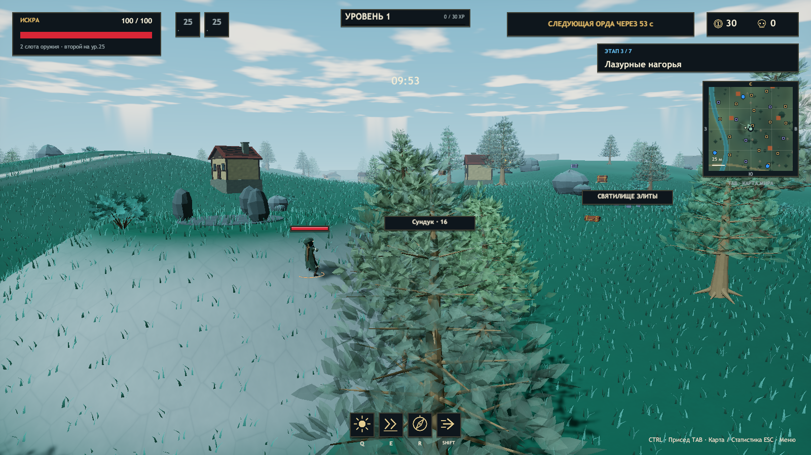
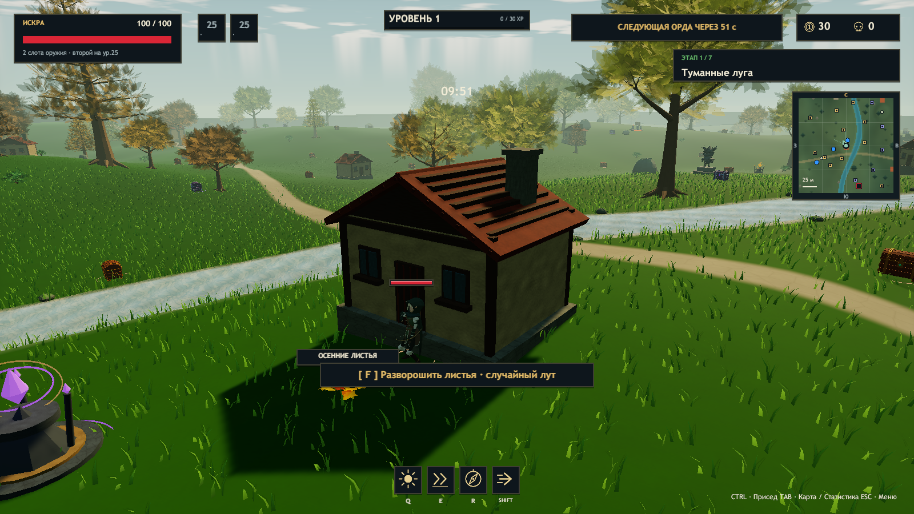

# ERA v0.22.1 — прозрачная пышная листва и баланс

Ветка `codex/autumn-passives-auras`, Unity 2023.1.22f1, Windows x64, 27 октября 2026 года.

## Изменения

- Листва использует полупрозрачный материал с непрозрачностью 58% и мягкой вариацией по текстуре. Убраны сплошные сердцевины лиственных и хвойных крон. Вместо них — больше отдельных листьев и хвои с ветром и объёмным распределением. Меши по-прежнему сгруппированы; у дерева два рендерера.
- У обычных мобов на 8% меньше максимального здоровья. Сохранены множители миров, волн и кооператива, здоровье боссов и урон врагов.
- Лучнику и Эхо добавлено 12 к базовому урону оружия и атакующей Q перед множителями. Бонус действует и на второе оружие. Предмет «Раскол души» использует обновлённую базу оружия.
- Лучник: лук 26 → 38, Q 65 → 77 до бонусов. Эхо: посох 24 → 36, Q 35 → 47 до его базового множителя 90%; фактически 21.6 → 32.4 и 31.5 → 42.3 соответственно.
- У Люмена прежние 10 базового DPS ауры, 45 урона Q и базовый урон дополнительного оружия. Общие реликвии сохраняют свои значения.
- Экран персонажа показывает его базовый урон оружия и обновлённый урон Q.

## Границы проверки

Кадры и автоматические прогоны не подтверждают длительный ручной баланс, производительность на слабых видеокартах или кооператив на разных физических ПК. Эти сценарии отдельно не проверялись.

Проверенная Windows-игра находится в `Builds/Windows/Era.exe`; для переноса нужна вся папка `Builds/Windows`.

## Автоматические проверки

`Tools/Build.ps1`: `ERA_CHECKS_OK 44085 assertions`, `Build Finished, Result: Success.`, `ERA_BUILD_OK 730438461 bytes`.

Новые проверки используют реальные созданные объекты врагов и попадания оружия/Q: снижение HP всех обычных типов на 8%, прежнее здоровье босса, +12 базового урона у лучника и Эхо, исходящий множитель Эхо и прежний урон Люмена. Проверки геометрии требуют отдельных полупрозрачных листьев без сплошной оболочки, объёмного силуэта, непустых мешей и двух рендереров дерева.

| Прогон | Результат |
|---|---|
| Environment | PASS: полупрозрачная листва без оболочек, вода, карта, смена мира; 726 рендереров |
| Balance | PASS: каталог, приседание, щит, уклонение, подсказки и 240 сундуков |
| Roguelike | PASS: 129 предметов, 12 моделей существ, каталог, подсказки и бой |
| Solo | PASS: пауза, продолжение, выбор аксессуаров и лут |
| Co-op, три процесса | PASS у хоста и двух клиентов: `ok=true`, три игрока, уровень 26, ауры, второе оружие и сложность |
| Update | PASS: волны, статуя, пять элитных стражей, бесплатный сундук, 72 ресурса, отдача, музыка и стены |
| Campaign | PASS: семь миров, семь боссов, шесть порталов, сохранение билдов, трава и модель Люмена |

Полные отчёты и SHA256 игровой C#-сборки: [foliage-balance-validation-v0221.json](foliage-balance-validation-v0221.json). В графических журналах финальных прогонов не найдено исключений, ошибок шейдеров или загрузки ресурсов. `git diff --check` пройден.

## Кадры из финального Windows Player

Кадры просмотрены визуально; проверены лиственные и хвойные кроны.

