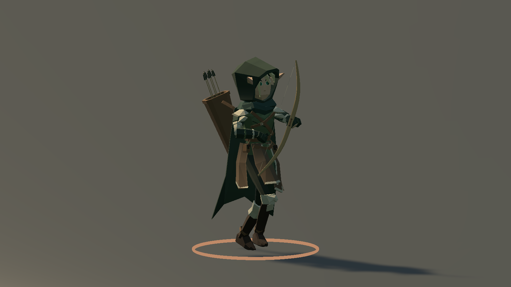
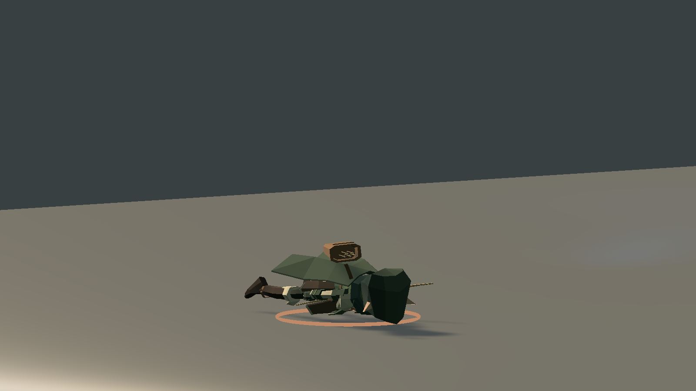

# ERA v0.23.1 — проверка Windows-релиза

Unity **2023.1.22f1**, Windows x64, фактическая версия Player **0.23.1** из Application.version. Основа — `46d9009`; включены все изменения после v0.23, включая анимационный quality-pass и Character Factory в исходниках. В этой подготовке изменены версия, документация и упаковка; модели, баланс и механики повторно не перерабатывались.

## Сборка

`ERA_CHECKS_OK 46971 assertions`, `Build Finished, Result: Success.`, `ERA_BUILD_OK 732683789 bytes`. Полные результаты и SHA256 управляемой сборки/данных игры: [release-validation-v0231.json](release-validation-v0231.json).

## Свежие проверки именно этой сборки

| Проверка | Результат |
|---|---|
| ArcherActions | PASS: Player 0.23.1, 26 клипов существуют/импортированы/назначены; 6 выстрелов / 6 событий; авторская Death включена по умолчанию |
| ArcherQuality, ограничение 30 FPS | PASS: 16 выстрелов / 16 событий; RunCast 24/24, RunCastShoot 26/26 кадров с locomotion; воздушные состояния сохраняются |
| Campaign | PASS: 7 миров, 7 боссов, 6 порталов, сохранение билдов и модель Люмена |
| Solo | PASS: пауза/возврат, выбор аксессуаров и лут |
| Co-op, 3 отдельных процесса | PASS у хоста и двух клиентов: подключение/готовность/прыжки/действия/благословение/ауры/второе оружие/сложность |
| Animation stress | PASS: 90 врагов, 384 снаряда, 320 эффектов; пауза и очистка |
| Environment | PASS: прозрачные вода/листва, карта, смена мира, 32 здания, случайные листья и три ауры; 726 рендереров |

[Runtime лучника](archer-runtime-v0231.json) · [Совмещения](archer-quality-v0231.json) · [Кампания](campaign-smoke-v0231.json). Остальные отчёты включены в общий JSON. Первые 16 основных клипов наблюдались в action-тесте; направленные и воздушные варианты — в quality-тесте. Подробный статус отдельных клипов сохранён в [анимационном аудите](ANIMATION-QUALITY-AUDIT.md).

Первый кооперативный прогон завершился `blessing=false` у всех участников; остальные флаги прошли. Повторный прогон **того же Player** прошёл полностью. Точная причина первого сбоя не установлена; это не объявляется доказанной ошибкой анимаций или исправленной механикой. Исходный неуспешный результат хоста сохранён в общем JSON.

## Визуальная проверка

Кадры получены из реального игрового экземпляра; они не заменяют непрерывную проверку всех контактов.

## ZIP

`Tools/Package.ps1` создаёт полный `Era-Windows.zip` с Era.exe, Era_Data, UnityPlayer.dll, MonoBleedingEdge, лицензиями и инструкциями. `Tools/Verify-Package.ps1` сверяет SHA256 **каждого** файла архива с проверенным build, версию runtime-отчёта, hash игровой C#-сборки и globalgamemanagers. Рядом публикуется `Era-Windows.zip.sha256`. Все участники используют v0.23.1.

## Ограничения

Сохраняются отдельные контакты руки/капюшона до 16,1 мм и расхождение muzzle до 18,3 см в некоторых крайних позах. Одежда лёжа требует дальнейшей проверки; DodgeRoll не является готовой новой игровой механикой. Кооператив проверен на одном ПК, не через LAN разных физических машин. Длительный ручной забег не выполнен. Ранее выполненные 15/60 FPS и проверки 31 набора актёров находятся в историческом quality-аудите; здесь они не выдаются за новые прогоны версии 0.23.1.
