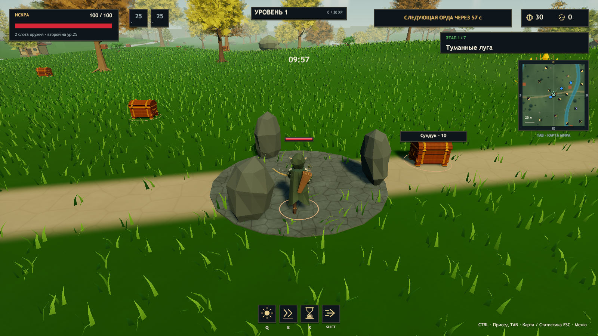

# ERA v0.23.2 — проверка исправления камеры

Unity **2023.1.22f1**, Windows x64, фактическая версия Player **0.23.2**. Основа — актуальный `main` `61a9684` (v0.23.1). Модели, риги, клипы и их контроллеры не изменены; пробная модель Люмина сохранена вне проекта ERA.

## Доказанная причина

`GameApp.Update` выполняет `Simulation.Step` с частотой **30 Гц**. `ArcherAnimationDriver.Present` привязывает корень лучника к текущей координате симуляции, чтобы сохранить регистрацию лука/стрелы. Раньше `ArenaView.FollowCamera` непосредственно брал этот корень как ориентир `LookAt`. На более высокой частоте рендера ориентир чередовал остановки и скачки. Позиция самой камеры уже сглаживалась, но её поворот каждый кадр пересчитывался по ступенчатой цели.

В диагностической сборке на исходниках v0.23.1, без движения мыши, врагов и получения урона, зарегистрировано **160 остановок цели из 326 измеренных кадров** при ограничении 60 FPS. В каждом из четырёх направлений ошибка равномерности движения цели RMS составляла 0,98–0,99.

## Исправление и сравнение

У камеры лучника отдельная цель. Для локального хоста она интерполируется по двум соседним шагам и остатку времени симуляции; для сетевого клиента сглаживается между снимками. Положение самого персонажа и логика выпуска стрелы сохранены. При новом сеансе, смене мира или большом телепорте предыдущий образец отбрасывается.

| Итоговый Player | Направления | Измеренные кадры | Остановки цели | Максимальная RMS ошибки скорости цели |
|---|---|---:|---:|---:|
| Ограничение 60 FPS | вперёд / назад / влево / вправо | 353 | 0 | 0,00000233 |
| Ограничение 30 FPS | все четыре | 180 | 0 | 0,00000147 |
| Ограничение 15 FPS | все четыре | 91 | 0 | 0,00000067 |

Измеряется **фактическая цель обычной игровой камеры**, используемая в `FollowCamera`; тест не подменяет её ракурс. В старой реализации целью был корень, поэтому исходный отчёт называет тот же показатель `rootSpeedErrorRms`; в итоговом — `targetSpeedErrorRms`. Это проверка устранения ступенчатого ориентира, а не обещание постоянных FPS на любом оборудовании. [JSON до/после](camera-motion-v0232.json), [исходные покадровые CSV](CameraMotion-v0232).

## Проверки итоговой сборки

| Проверка | Результат |
|---|---|
| Сборка и редакторские проверки | PASS: 46 971 assertions, Windows Build Success |
| Камера | PASS: 15 / 30 / 60 FPS, обычные игровые ввод и движение во всех четырёх направлениях |
| ArcherRefinement, 30 FPS | PASS: 5 прыжков / 5 приземлений, 8 выстрелов / 8 событий, включая выстрел в воздухе |
| Регистрация выстрела | Корень совпадает с игровой позицией; максимальный зазор точки выпуска: 5,8 см в JumpShoot и 13,2 см в RunShoot; ошибка направления 0° |
| ArcherActions | PASS: 26 клипов существуют, импортированы и назначены; 6 выстрелов / 6 событий; авторская Death сохранена |
| Другие герои | Echo и Lumen: наблюдалось движение ног при ходьбе и беге в runtime-тесте |
| Кампания | PASS: 7 миров, 7 боссов, 6 порталов, переходы и сохранение билдов |
| Solo | PASS: пауза и возврат, выбор улучшений, анимированный лут |
| Co-op, три процесса | PASS при повторном изолированном прогоне: хост и два клиента, готовность, прыжки, действия, благословение, ауры, второе оружие, сложность |

Первый прогон кооператива одновременно с другими проверками завершился `blessing=false`; остальные флаги прошли. Повтор **того же Player без изменения кода** прошёл у всех трёх участников. Причина первого сбоя не установлена; аналогичный результат был документирован для v0.23.1. [Первый результат сохранён](coop-first-v0232.json), он не объявляется исправленной ошибкой благословений.

[Полные результаты и SHA256 C#-сборки/данных](release-validation-v0232.json) · [Анимации](archer-runtime-v0232.json) · [Прыжки и стрельба](archer-refinement-v0232.json) · [Кампания](campaign-smoke-v0232.json).

## Упаковка и ограничения

`Era-Windows.zip` содержит полную Windows-игру с `Era.exe`, `Era_Data`, `UnityPlayer.dll`, `MonoBleedingEdge` и инструкциями. `Tools/Verify-Package.ps1` сверяет каждый файл ZIP с проверенной сборкой, версию runtime-отчёта, SHA256 игровой сборки и `globalgamemanagers`. Рядом публикуется SHA256 архива.

Точечное исправление не меняет частоту самой симуляции или анимационных клипов. Камера хоста получает до 33,3 мс задержки интерполированной цели; сглаживание клиентской камеры не заменяет сетевое предсказание. Кооператив проверен на одном ПК в трёх процессах, без проверки реального WAN/потерь пакетов. Долгий ручной забег не выполнен. Сохраняются художественные ограничения анимаций из предыдущего аудита.
