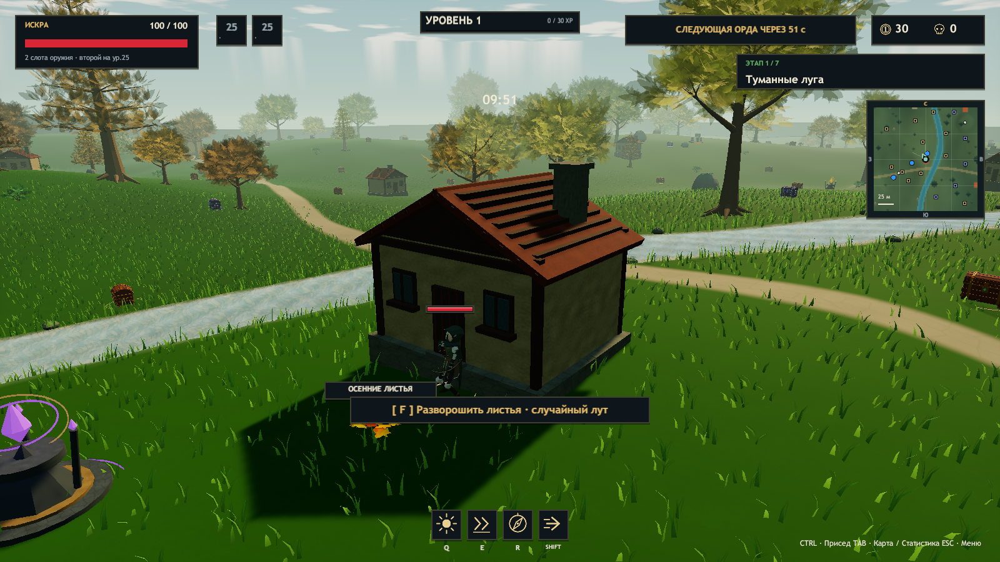
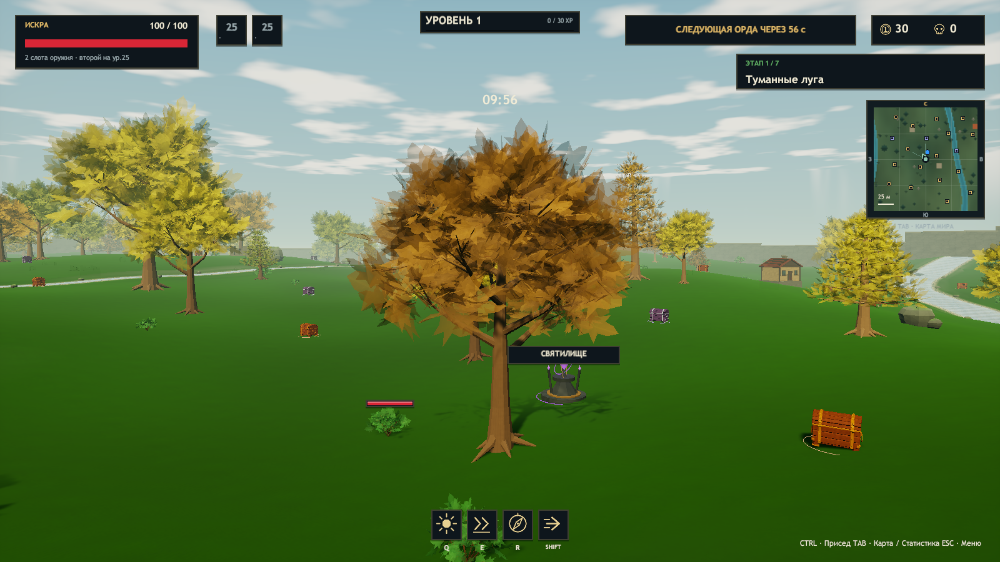
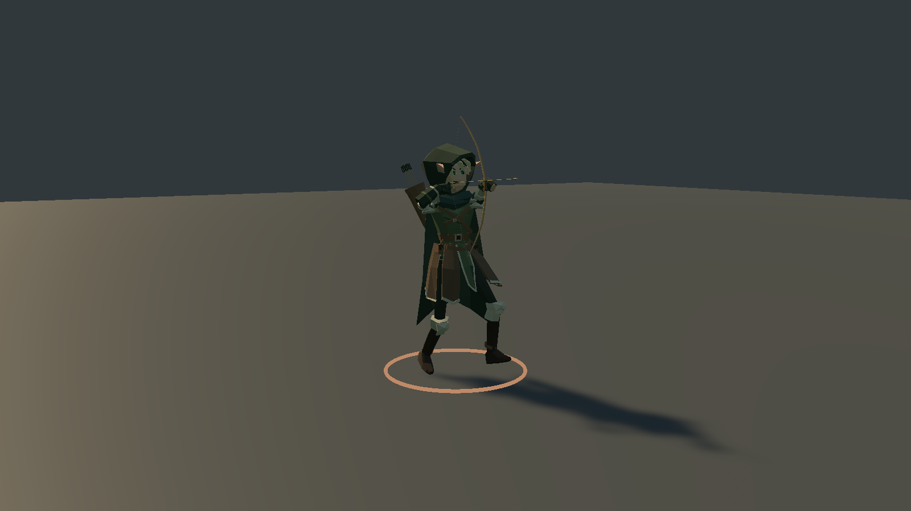
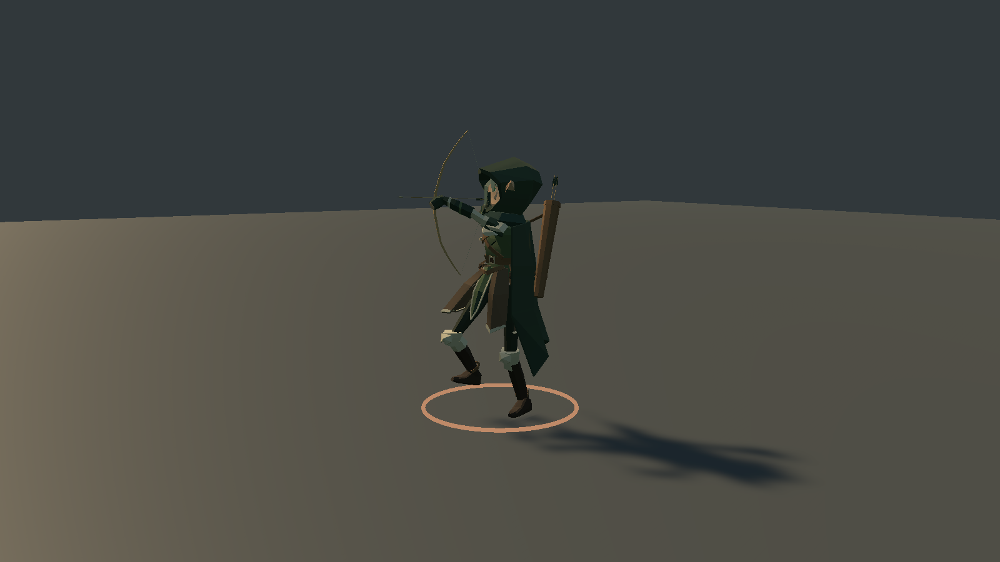

# ERA v0.23 — объединённая версия

Unity 2023.1.22f1, Windows x64, версия Player 0.23.0. Выпуск объединяет изменения `main` (`6e0efa8`) и `codex/autumn-passives-auras` (`ce3deff`), а также новые HP боссов.

## Включено

Направленные движения и стрельба лучника, инерция экипировки, пассивки всех трёх героев, три случайные карточки аур Люмена, осенний случайный лут, домики/руины, пышная полупрозрачная листва, −8% HP обычных мобов и +12 базового урона оружия/Q лучнику и Эхо.

Базовые HP боссов по мирам: 2500 / 5000 / 5500 / 6500 / 7500 / 10000 / 12000. Проверки создают настоящих боссов во всех семи мирах для одного, двух и трёх игроков и проверяют прежние множители ×1 / ×2 / ×4.

Исторические отчёты обеих веток сохранены: [движения v0.22](VALIDATION-v0.22.md), [пассивки и осень](VALIDATION-AUTUMN-v0.22.md), [прозрачная листва и баланс](VALIDATION-v0.22.1.md).

## Сборка и проверки проекта

`ERA_CHECKS_OK 45927 assertions`, `Build Finished, Result: Success.`, `ERA_BUILD_OK 732192045 bytes`.

Проверки включают ауры, очередь уровней, пассивки, формулу рикошетов, предметы и баланс, HP боссов во всех мирах и режимах команды, коллизии, отдельные прозрачные листья, структуру рига и направленные анимации лучника.

В меню версия теперь берётся из `Application.version`. Исходники движений лучника/FBX совпадают с интеграцией `main`, а исходники пассивок, оружия, аур, предметов, обычных мобов и листвы — с осенней веткой; дополнительно изменена шкала боссов.

Свежие отчёты: [runtime лучника версии 0.23.0](archer-runtime-v023.json), [16 сценариев движения](archer-motion-release-v023.json). В runtime: 6 выстрелов / 6 событий, без потерянного выпуска; в сценариях движения: 8 выстрелов / 8 событий при ограничении 30 FPS.

Кадры окружения, бега/прицеливания и поворота/стрельбы просмотрены визуально.

## Runtime-проверки объединённой сборки

| Прогон | Результат |
|---|---|
| Archer runtime | PASS: Player 0.23.0, 54 кости, 23 skins, 22 клипа, 6 выстрелов / 6 событий, без потерянной release-позы |
| ArcherMotion, ограничение 30 FPS | PASS: 16 сценариев, 8 выстрелов / 8 событий, конечная и затухающая инерция экипировки |
| Environment | PASS: прозрачная листва и вода, карта, смена мира, дома и случайные листья, три ауры; 726 рендереров |
| Balance / Roguelike | PASS: баланс, щит/уклонение, каталог 129 предметов, 12 моделей существ, подсказки и бой |
| Solo | PASS: пауза/продолжение, аксессуары и лут |
| Co-op, три отдельных процесса | PASS у хоста и двух клиентов: `ok=true`, `players=3`, `auras=true`, `secondWeapons=true`, `difficulty=true` |
| Campaign | PASS: семь миров, семь боссов, шесть порталов, сохранение билдов |
| Characters | PASS: семь моделей, skins, клипы и присед |
| Rig | PASS: 108 поз оружия и 36 Generic-поз, привязки и коллайдеры |
| Animation | PASS: 90 врагов, до 384 снарядов и 320 эффектов, 48 слотов обратной связи, пауза и очистка |
| Chests | PASS: рост цен, модели, анимация крышки, выбор и улучшение аур, снимок состояния |
| Update / Art | PASS: волны, статуя, пять элитных стражей, бесплатный сундук, 72 ресурса, отдача, музыка, святилище и награды |

Полный набор свежих отчётов и SHA256 игровой C#-сборки: [merged-validation-v023.json](merged-validation-v023.json). Во всех графических журналах этих прогонов отсутствуют исключения и ошибки шейдеров/загрузки ресурсов. `git diff --check` пройден. Кооператив проверен тремя процессами на одном компьютере.

## Ограничения

Автоматические прогоны и просмотр кадров не заменяют длительный ручной забег и LAN-игру на разных физических ПК. Сохраняются известные ограничения анимаций из [ARCHER-MOTION.md](ARCHER-MOTION.md).

## Архив

`Tools/Verify-Package.ps1` требует runtime-отчёт версии 0.23.0, успешные отчёты объединённой проверки и соответствие SHA256 игровой C#-сборки. Каждый файл ZIP сравнивается с протестированной папкой Windows Player. SHA256 архива опубликован отдельным файлом.
