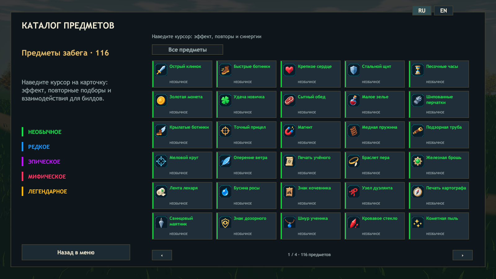
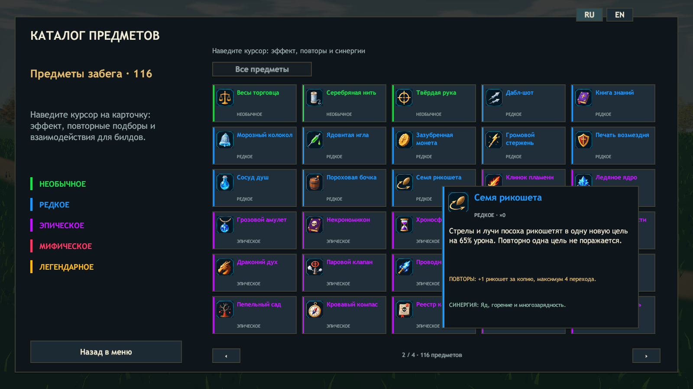

# Проверки ERA v0.24

Дата: 27 октября 2026. Unity 2023.1.22f1, Windows x64. Баланс наложен на свежую `main` (`3c1942f`), включая анимации v0.23.1, исправление камеры v0.23.2 и ассет Aura Weaver в исходниках. Модели и камера не откатывались к ранней v0.23.

## Проверяемые правила

- В каталоге и выпадении 116 предметов: 33 необычных / 10 редких / 38 эпических / 21 мифический / 14 легендарных. Исключены 13 из 23 редких, то есть 56,5%. Старые номера зарезервированы; исключённые предметы нельзя выдать даже напрямую через `ApplyItem`.
- `LootBalanceChecks` открывает 7200 настоящих сундуков с фиксированными seed: каждый герой, обычный/лунный сундук, удача 0/100. Все 116 активных предметов встретились, исключённые не встретились; награда на полу совпадает с броском.
- Во всех семи мирах по 30 сундуков, в том числе шесть лунных. Позиции проверены относительно поверхности. Наградной бесплатный сундук за стражей — дополнительный.
- Фактическое перемещение всех героев проверено с обычным бегом и приседом: 8,268 м/с и множитель 0,43, то есть +6% к прежней базе 7,8 м/с.
- Проверены сохранение обычного шанса крита со Станком судьбы, гарантированный каждый четвёртый удар, пределы повторов Септической раны / Зеркального осколка / Короны затмения / Ленты Мёбиуса, усиленные огонь/молния/лечение/щит и опыт Книги знаний при максимальном оружии.
- Сохранены правила Дабл-шота, пассивки за уровни, предложения аур Люмена и ОЗ боссов 2500 / 5000 / 5500 / 6500 / 7500 / 10000 / 12000 до множителей команды.

## Сборка

`Tools/Build.ps1` для итогового объединённого кода:

```text
ERA_CHECKS_OK 68851 assertions
Build Finished, Result: Success.
ERA_BUILD_OK 732691117 bytes
```

SHA256 `Era_Data/Managed/Assembly-CSharp.dll`: `34a838880f4514e85c57dcdd8902c0e9102431351021ba185325b37eab421d07`.

SHA256 `Era_Data/globalgamemanagers`: `e2566aeedf7e41d22dda61b462ccd80175876e6e299190b82eefbdb79619f9d8`.

## Проверки готового Player

Все 12 сценариев выполнены заново после объединения с main, на той же сборке v0.24, которая упакована для релиза. 14 свежих JSON-отчётов (включая три участника кооператива) объединены в loot-balance-validation-v024.json; даты отчётов проверены относительно собранной DLL.

| Сценарий | Результат |
| --- | --- |
| Test-Balance | Каталог/подсказки, 116 активных и 10 редких предметов, 30 сундуков, щит, уклонение, ОЗ босса — PASS. |
| Test-Roguelike | 116 предметов, 12 моделей, каталог, подсказки и бой — PASS. |
| Test-Chests | Модель/открытие/награда, рост цены, ауры и snapshot — PASS. |
| Test-Solo | Пауза/продолжение, аксессуары, предметы и лут — PASS. |
| Test-Update | Волны, статуя, пять стражей, дополнительный бесплатный сундук, 72 листовых ресурса, музыка — PASS. |
| Test-Campaign | 7 миров, 7 боссов, 6 порталов, прыжок и Люмен — PASS. |
| Test-Feedback | 90 врагов, предел 48 слотов эффектов и 16 голосов, статусы/щит/лечение/скорость, очистка, 0 ошибок — PASS. |
| Test-Archer | 26 клипов, стрельба/выпуск стрелы, конечные значения, включённая штатная Death — PASS. |
| Test-CameraMotion | Обычная камера, лучник, режим 60 FPS, четыре направления без остановок цели — PASS. |
| Test-ArcherRefinement | Режим 30 FPS, 16 фаз, 5 прыжков и приземлений, 8 выстрелов / 8 событий — PASS. |
| Test-AnimationEnsemble | 31 объект, режим 30 FPS, 0 ошибок — PASS. |
| Test-Coop -ThreeProcesses -Headless | Host/client/client2: ok=true, 3 игрока, ауры, второе оружие и сложность — PASS. |

В графических логах этих сценариев нет исключений, ошибок загрузки или шейдеров. Предупреждения неподдерживаемых шейдеров в headless кооперативе относятся к NullGfxDevice; графические сценарии отдельно прошли.





Tools/Verify-Package.ps1 сверяет весь архив с тестированным каталогом Windows, хеш DLL и globalgamemanagers, текущий отчёт баланса, все сохранённые результаты и SHA256 архива.

## Что не подтверждают эти проверки

Долгие ручные забеги для оценки субъективного баланса, кооператив на разных физических ПК и производительность слабых видеокарт отдельно не проверялись. Билд включает прежние ограничения качества анимаций, описанные в `ANIMATION-QUALITY-AUDIT.md`.
