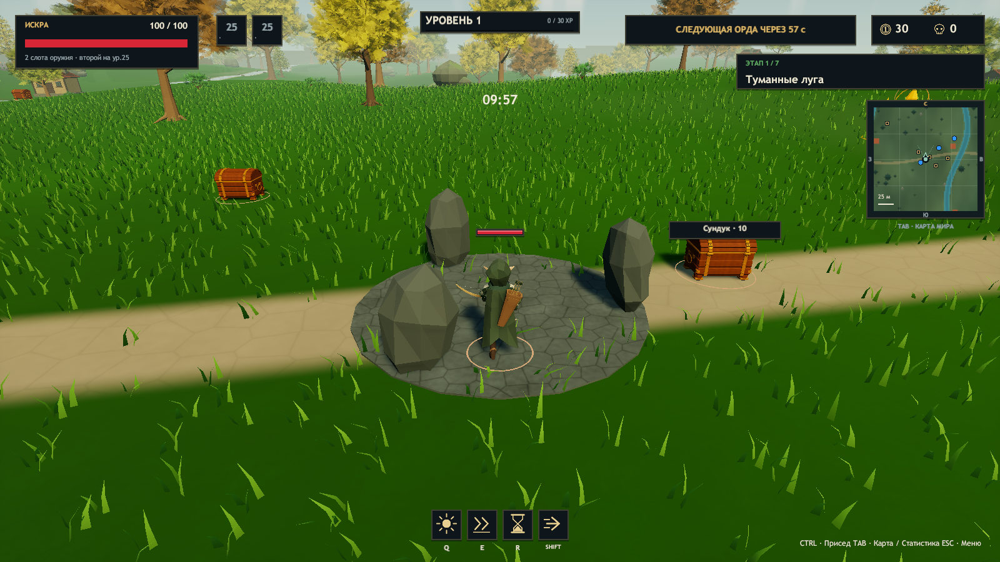

# ERA v0.25.1 — проверка движения персонажа при высоком FPS

## Причина и исправление

В исходниках v0.25 `ArcherAnimationDriver.Present` выполнял `actorRoot.position = p.position` для локального игрока. `GameApp.Update` меняет эту авторитетную позицию только по шагам 1/30 с. После v0.23.2 камера получала отдельную интерполированную цель, а модель всё ещё переставлялась ступенями. Это подтверждается кодом до исправления и покадровой сырой траекторией в новых CSV. Анимационные клипы не были ограничением 30/45/60 FPS: Animator оценивает их между ключами.

В v0.25.1 локальный хост получает позицию модели через `GameApp.LocalPresentationPosition`: линейная интерполяция двух последних позиций с коэффициентом остатка аккумулятора. У камеры больше нет отдельного маршрута сглаживания — она следует тому же корню. Для клиента сохранена прежняя интерполяция снимков в `ArenaView`, а принудительное перезаписывание позиции удалено. Сохранены проверки смены мира, сеанса и телепорта. Система не привязана к перечню FPS.

Не менялись шаг симуляции, скорость героя, ввод, расчёт коллизий Simulation, профили выстрела/урон, Animator Controller, Blender и клипы. Физические попадания не зависят от отрисовки.

## Windows Player: движение в четырёх направлениях

Замер идёт через обычные GameApp/Simulation/Animator/ArenaView, без подмены ракурса или координаты модели тестом. Враги и урон отключены в тестовой сцене. Окно измерения исключает старт/синхронный захват скриншота. «Остановка» — скорость корня менее 2% ожидаемой при продолжающемся движении; RMS — ошибка скорости корня относительно игровой скорости.

| Герой / заданный FPS | Фактический FPS по фазам | Кадры | Остановки модели | Максимальная RMS |
|---|---:|---:|---:|---:|
| Лучник / 30 | 28.92–30.00 | 179 | 0 | 0.00000146 |
| Лучник / 60 | 57.81–59.98 | 357 | 0 | 0.00000258 |
| Лучник / 150 | 149.45–149.85 | 899 | 0 | 0.00000590 |
| Лучник / 240 | 225.64–239.59 | 1415 | 0 | 0.00000997 |
| Эхо / 150 | 149.27–149.90 | 898 | 0 | 0.18856 |
| Люмен / 150 | 149.69–149.93 | 900 | 0 | 0.18870 |

Эхо и Люмен сохраняют прежнее экспоненциальное сглаживание; их ненулевая пульсация скорости не объявляется исправленной. Главная правка относится к лучнику. У него измеренная позиция камеры и корень совпадают. При 150 FPS сырая авторитетная траектория имеет 719 неподвижных кадров из 899 (~80%); это ожидаемо для 30 Гц и показывает, почему её нельзя напрямую рисовать. Это одновременное измерение raw-позиции, а не отдельный запуск старого Player.

[Покадровые JSON/CSV](CharacterMotion-v0251) · [Сводка и SHA256 проверенного Player](release-validation-v0251.json).

## Регрессии и сборка

- Unity **2023.1.22f1**, Windows x64: Build Success, **72 115** редакторских assertions.
- ArcherRefinement, 150 FPS: 5 прыжков, 5 приземлений, 8 выстрелов / 8 событий, в том числе в воздухе; `ok=true`, ошибок runtime нет.
- ArcherActions: 26 клипов, 6 выстрелов / 6 событий, Death включена. Сохранены прежние художественные ограничения движений.
- Кампания: 7 миров, 7 боссов, 6 порталов, прыжок и модель Люмена — PASS.
- Предметы: 129 иллюстраций, 116 активных, прозрачность, траектории, цвета и редкости — PASS.
- Кооператив: хост + 2 клиента на одном ПК, 3 игрока, готовность, прыжки, сундуки, второе оружие, ауры и сложность — PASS. Реальная WAN-сеть и визуальная плавность клиента при потерях пакетов не проверялись.

Первый запуск Unity в песочнице завершился кодом 199 на Licensing Client. После запуска с доступом к локальному клиенту лицензирования сборка завершена успешно. В первом PowerShell-постусловии ArcherRefinement планарная скорость ошибочно использовалась для ограничения 3D-задержки прыгающего героя; это условие исправлено. Проверены существующие результаты того же Player, повторное создание клипов не проводилось. Сам runtime-тест уже имел `ok=true`.

## Стрельба и задержка отображения

Корень модели намеренно отстаёт от авторитетной позиции до одного шага, **33.3 мс**. При JumpShoot измерен максимум 0.295 м в 3D, при RunShoot — 0.277 м. Расхождение сокета с профилем относительно **видимого** корня: 0.069 / 0.121 м, ошибка направления 0°. Корень совпадает с часами отображения (ошибка 0). Сырые расстояния до авторитетного профиля сохранены: 0.351 / 0.359 м; они не выдаются за нулевые. Логика снарядов сохранена, сетевое предсказание не добавлялось.

## Архив

`Era-Windows.zip` содержит полную игру: `Era.exe`, `Era_Data`, `UnityPlayer.dll`, `MonoBleedingEdge`, инструкции и отчёты. `Tools/Verify-Package.ps1` проверяет версию 0.25.1, SHA256 данных/сборки, все тесты сводки и побайтовое совпадение каждого файла ZIP с проверенной Windows-сборкой. Рядом публикуется SHA256 архива. Готовый ZIP будет приложен к релизу v0.25.1.

