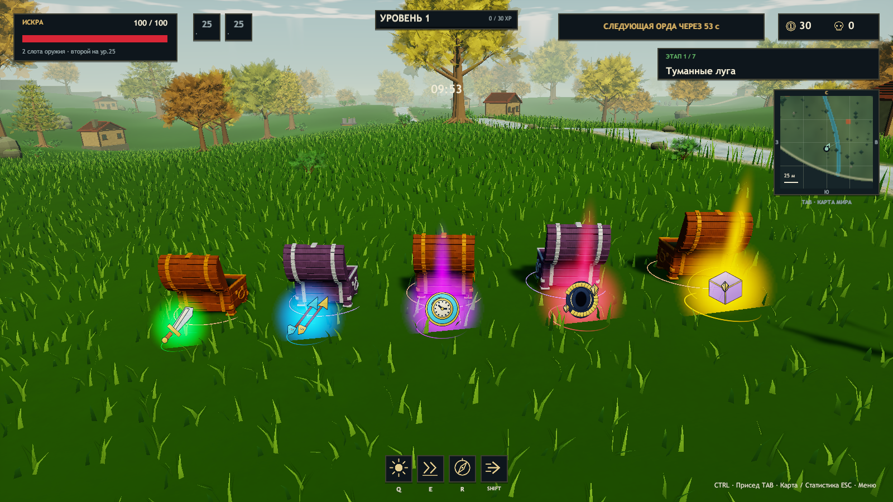
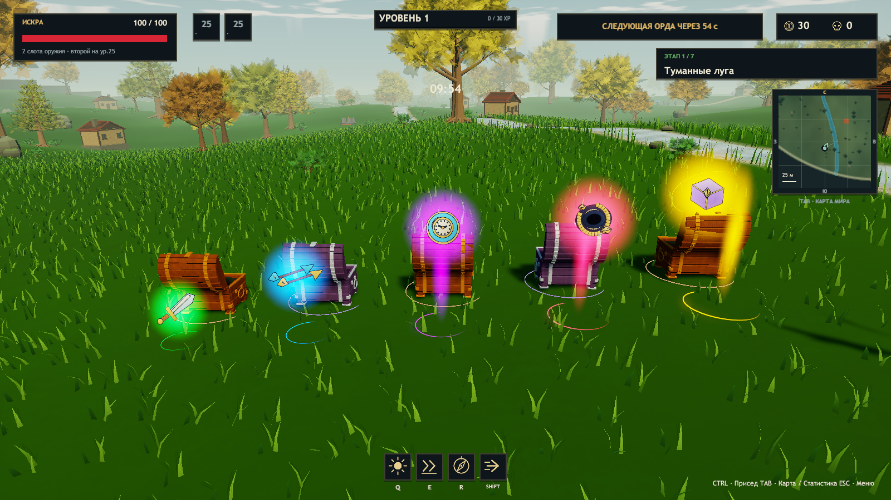
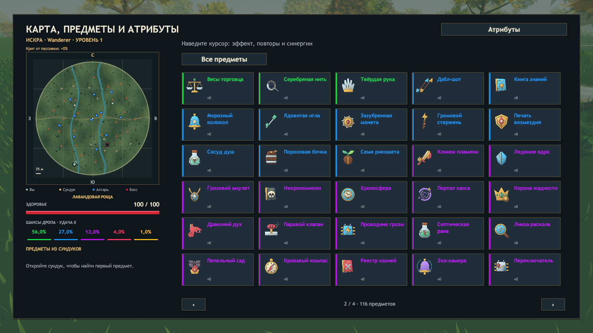

# Проверки ERA v0.25 — изображения предметов и анимации лута

27 октября 2026, Unity 2023.1.22f1, Windows x64. Исходная main: v0.24, коммит 2ddf0218b670dd58061d93c0dd6fa3916f502644. Предыдущие пассивки, баланс, 30 сундуков, камера и персонажи сохранены.

## Изображения

- Проверены все 129 стабильных ItemId: отдельный PNG 256×256 и редактируемый SVG. Все 116 доступных предметов покрыты; 13 исключённых остаются исключёнными из игры.
- У всех PNG есть реальные прозрачные пиксели вокруг предмета, пустые внешние края и видимый центрированный силуэт. На каждом рисунке прозрачны более 40% пикселей. Фон, карточки, названия и полоски редкости не запечены в иллюстрацию.
- Проверены уникальные SHA256 всех PNG, соответствие имени файла стабильному ID, загрузка отдельных Texture2D, Sprite и полная UV-область. Общих заменителей для последних легендарных предметов нет.
- В готовом Player отдельно проверены 129 различных текстур и альфа-канал. Каталог всех 116 активных предметов снят на четырёх страницах. Новые картинки используются в меню, Tab, подсказках, уведомлениях и на земле.

## Анимации и свечение

- Пять траекторий проверены для всех пяти рангов: начало внутри сундука, конечная позиция над местом добычи, конечные числа и положительный масштаб на протяжении всего полёта.
- Копия состояния через JSON воспроизводит ту же траекторию. Протокол 17 передаёт launchOrigin/fromChest вместе с возрастом и ID находки.
- Проверены порядок и цвета: редкое зелёное → сверхредкое синее → эпическое фиолетовое → мифическое малиновое → легендарное золотое. Внутренние значения enum и вероятности выпадения не менялись.
- Настоящий сундук создаёт лут со стартом вылета; конечная точка выбирается в сторону открывшего игрока. Подбор в полёте начинается с позиции траектории и выдаёт ровно одну копию.
- В Player сняты вылет, промежуточные дуги, установившееся свечение и подбор. Пять объектов показывают пять разных вариантов анимации. Предел — 24 частицы на предмет, без реальных источников света и коллайдеров.

## Сборка

```text
ERA_CHECKS_OK 72115 assertions
Build Finished, Result: Success.
ERA_BUILD_OK 766552633 bytes
```

SHA256 Assembly-CSharp.dll: `26160997e3005e152ae9c4bf6610cb6eb3e57da7d628855c75b8ec2a7fd92646`.

SHA256 globalgamemanagers: `3d3761852ef8235778dc15f1122c49e2c292ea31dfffb7562a9494f8809ba3e1`.

Точные результаты готового Player сохраняются в item-art-runtime-v025.json и item-art-validation-v025.json. Вторая сводка привязана к обоим хешам этой сборки. Tools/Verify-Package.ps1 сверяет весь Windows ZIP с протестированными файлами; Tools/Package-ItemArtwork.ps1 отдельно сверяет все 129 PNG и 129 SVG внутри архива рисунков.

## Проверки готового Player

После последнего изменения игрового кода заново выполнены 11 сценариев. Все 13 JSON-отчётов (включая три процесса кооператива) свежие относительно собранной DLL и включены в item-art-validation-v025.json.

| Сценарий | Результат |
| --- | --- |
| Test-ItemArt | 129 уникальных изображений, 116 активных, прозрачность, все пять вылетов и цветов, подбор, snapshot и четыре страницы каталога — PASS. |
| Test-Balance | Каталог/подсказки, щит, уклонение, ОЗ босса, 30 сундуков — PASS. |
| Test-Roguelike | 116 предметов, модели, подсказки и боевые эффекты — PASS. |
| Test-Chests | Цена/открытие/награда, ауры и сериализация — PASS. |
| Test-Solo | Пауза/продолжение, аксессуары, предметы и лут — PASS. |
| Test-Art | Модели, алтари, присед, прыжки, описания и кристаллы — PASS. |
| Test-Update | Волны, статуя, стражи и бесплатный сундук, листовые ресурсы и музыка — PASS. |
| Test-Campaign | 7 миров, 7 боссов, 6 порталов — PASS. |
| Test-Feedback | 90 врагов, 48 слотов, 16 голосов, статусы/щит/лечение, очистка — PASS. |
| Test-Animation | 90 врагов, 384 снаряда, 320 эффектов, пауза и очистка — PASS. |
| Test-Coop -ThreeProcesses -Headless | Host/client/client2: ok=true, 3 игрока, ауры, второе оружие и сложность — PASS. |

В графических логах этих сценариев нет исключений, ошибок загрузки и шейдеров. В headless кооперативе ожидаемы сообщения неподдерживаемых шейдеров NullGfxDevice.

## Кадры готовой игры







## Границы проверки

Это автоматические проверки и просмотр реальных кадров на одном ПК. Долгая ручная игра, кооператив между разными физическими ПК и производительность слабых видеокарт отдельно не проверялись. Предыдущие ограничения анимаций персонажей не менялись.
