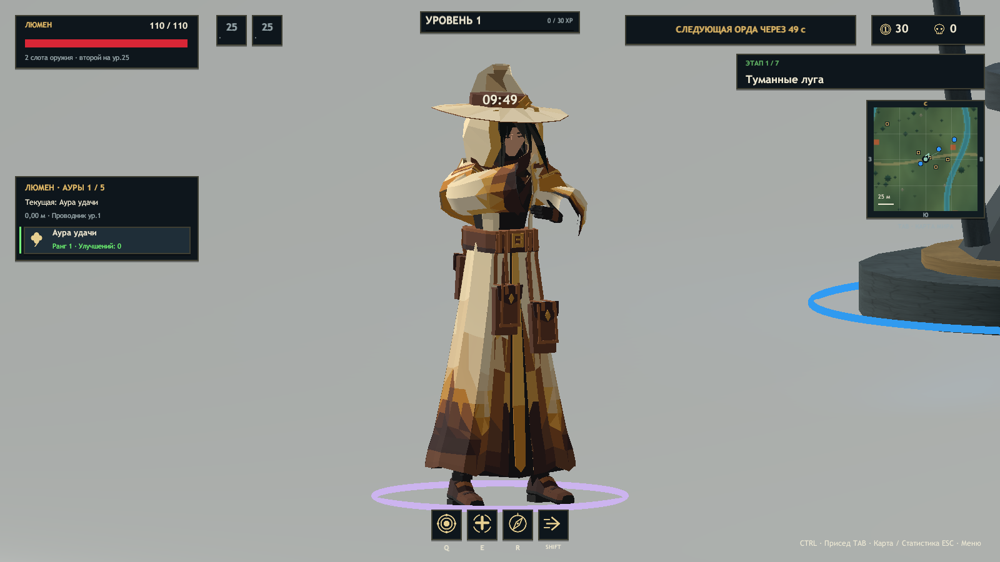

# Проверка ERA v0.26.0

Unity **2023.1.22f1**, Windows x64 Mono. Основа — актуальная `main` после V8 (`5d2d45c`). Механика Люмена, сериализация героев и численные параметры аур не изменялись.

## Модель и анимации

В `Characters/Lumen.prefab` установлен Aura Weaver V9, продолжение V8 с рисунком 09. Отдельный Generic Avatar, 26 skinned meshes, 8 680 треугольников, 90 костей; Root Motion отключён. Исходная V8 и исходники лучника сохранены.

Хвост шляпы направлен на **30° от +Y/назад в плане**, с увеличенным основанием изгиба. Rest landmarks скелета подогнаны под пропорции нынешней мантии, плеч, рук и головы. Четыре дополнительные кости сумок следуют запечённым опорам одежды; верх креплений связан с поясом.

Все 11 клипов существовали ранее: они адаптированы и переэкспортированы, новый комплект с нуля не создавался. Проверены реальные экземпляры Люмена в готовом Player, состояния Animator, движение костей и конечность координат запечённых мешей:

| Animation | Exists | Imported | Assigned | Runtime Tested |
|---|---|---|---|---|
| AuraWeaver_Idle | Да | Да | Да | Да |
| AuraWeaver_Walk | Да | Да | Да | Да |
| AuraWeaver_Run | Да | Да | Да | Да |
| AuraWeaver_JumpStart | Да | Да | Да | Да |
| AuraWeaver_Airborne | Да | Да | Да | Да |
| AuraWeaver_Fall | Да | Да | Да | Да |
| AuraWeaver_Land | Да | Да | Да | Да |
| AuraWeaver_AuraChannel | Да | Да | Да | Да |
| AuraWeaver_Cast | Да | Да | Да | Да |
| AuraWeaver_Hit | Да | Да | Да | Да |
| AuraWeaver_Death | Да | Да | Да | Да |

[Результат игрового теста](lumen-runtime-v026.json). Контрольная сцена использует настоящий игровой prefab и драйвер, подавая события PlayerState; окружение скрывается ради читаемости. Отдельные тесты кампании и движения используют обычную симуляцию и ввод. Это различие не скрывается.

[Idle](Lumen-v026/Runtime-Idle.png) · [Run](Lumen-v026/Runtime-Run.png) · [Cast](Lumen-v026/Runtime-Cast.png) · [Death](Lumen-v026/Runtime-Death.png) · [Студийный кадр Player](Lumen-v026/Character-studio.png).

[Blender Front](Lumen-v026/Blender-Front.png) · [Side](Lumen-v026/Blender-Side.png) · [Back](Lumen-v026/Blender-Back.png).

## Совместимость

- **73 607** проверок редактора: симуляция, ауры, предметы, сеть и скелеты, включая точные пути Generic-кривых Люмена и деформации каждого клипа в пяти фазах.
- Семь моделей в Player: скининг, анимации, приседание. Проверены Люмен, Искра/лучник, Эхо, библиотечные Wayfarer/DuskMage, Stalker/Wisp.
- Оружие: **108** контрольных поз, все шесть профилей; новые palm sockets Люмена совместимы с общим IK. Во время магического каста Aura-фокус скрывается, чтобы не перекрывать жест. Способности остаются в прежней Simulation.
- Люмен и лучник при запросе **150 FPS**: четыре направления движения, без остановок визуального корня. Общая с камерой интерполяция между тиками 30 Гц сохранена.
- Регрессия лучника: прыжки/приземления, стрельба на земле и в воздухе, события выпуска стрел, повороты и движение.
- Кампания: **7 миров, 7 боссов, 6 порталов**, прыжок, сохранение прогрессии и новой модели Люмена.
- Предметы: **129 изображений, 116 доступных ID**, прозрачность, цвета редкости, выпадение и каталог.
- Кооператив: localhost-хост и два отдельных клиента; готовность, действия, ауры, второе оружие и сложность.

Все машинные отчёты и SHA-256 проверенной сборки: [release-validation-v026.json](release-validation-v026.json). ZIP проверяется по каждому файлу из собранного Player; архив содержит игру, а не только исходники.

## Ограничения

- При Death остаются локальные пересечения сумок с мантией. В остальных 50 из 55 контрольных поз пересечений четырёх сумок с OuterCoat не обнаружено; BVH-проверка не гарантирует отсутствие всех возможных контактов.
- Мантия использует запечённую костную анимацию, без физической Cloth simulation.
- Совпадающие имена костей с лучником не делают rest pose одинаковой. Сертификация произвольного Humanoid-ретаргетинга не выполнялась.
- Проверка кооператива локальная, без WAN-задержек и потерь пакетов. Запрос 150 FPS не гарантирует такую производительность на каждом ПК.
