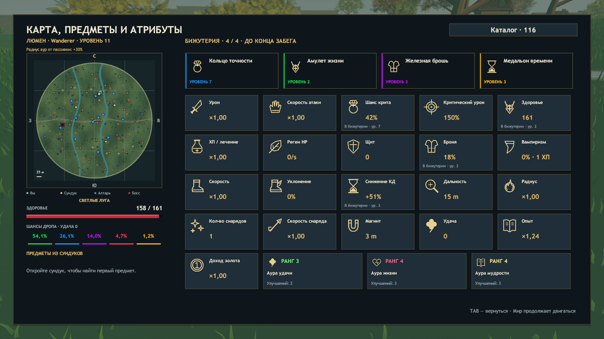

# ERA 0.27 — результаты проверки

Основа: `d94b8bf` / v0.26.1. Unity 2023.1.22f1, Blender 5.2.3 LTS, Windows x64. Финальная сборка завершилась успешно: **74 978 проверок**, `ERA_BUILD_OK 770797681 bytes`.

Полный машинный отчёт, SHA-256 сборки и все 13 свежих отчётов Player: [progression-validation-v027.json](progression-validation-v027.json). Проверены 11 сценариев; сетевой сценарий даёт три отдельных отчёта.

## Бижутерия и ауры

`AccessoryChecks` проверяет каждого из трёх персонажей на протяжении 120 повышений уровня: четыре постоянных типа, только три разных предложения из экипированных после заполнения, повторное увеличение уровней выше пятого, отсутствие скрытой награды за пятый тип, сохранение полей в JSON-снимке и пустой набор в новом забеге. Для Люмена дополнительно проверяется один выбор ауры на каждом уровне и предел в три изученных типа.

`Tools/Test-Accessories.ps1` подтвердил эту механику в готовом Player, передачу слотов/уровней через снимок и включение режима без лимита FPS. Сняты реальные экраны инвентаря, улучшения бижутерии, выбора ауры, HUD и настроек.

[Предложение улучшить экипированную бижутерию](Progression-v027/Accessory-upgrade.png) · [Выбор ауры после заполнения трёх типов](Progression-v027/Aura-upgrade.png) · [Режим FPS без лимита](Progression-v027/Fps-settings.png).

## Руки и движение Люмена

Сохранённые V10/V11 независимо сравнивались в Blender: rest skeleton и кривые всех 11 Actions совпадают. Кисти выведены из длинных рукавов; объёмная манжета связана с исходной перчаткой. Геометрические проверки не нашли открытых границ, ненормализованных весов или неконечных координат. [Исходник и измерения](../ArtSource/Characters/AuraWeaver/ReleaseV11/README.md).

`Test-Lumen.ps1`: все 11 клипов существуют, назначены контроллеру, проигрываются в Player и дают конечную деформацию. `Test-LumenMotion.ps1`: Idle, ходьба, ускоренный бег, боковое движение, прыжок, рывок, вид сверху и крупные планы рук прошли; Walk/Run достигают собственных весов 1.0, руна следует ладони. На проверенных вершинах и центрах треугольников мантии измеренное проникновение капсул ног — 0.

[Крупный план в игре](Progression-v027/Hands-0.png) · [Другой ракурс рук](Progression-v027/Hands-1.png) · [Ходьба](Progression-v027/Walk-0.png) · [Прежние скрытые рукавами кисти в Blender](Progression-v027/Before-hands.png).

## Полоска HP и FPS

Обычный ввод проходит через симуляцию; диагностика не переставляет корень модели и камеру. Для каждого режима проверяются четыре направления. Полоска здоровья использует отображаемую позицию героя, а не дискретное состояние 30 Гц. Во всех маршрутах число остановок модели и полоски между шагами симуляции — **0**; горизонтальное расхождение их опор — 0.

| Сценарий | Фактически измерено | Максимальная RMS-ошибка темпа полоски |
|---|---:|---:|
| Люмен, лимит 60 | 54.9–59.9 FPS | 0.0000027 |
| Люмен, лимит 240 | 129.2–132.9 FPS | 0.0000060 |
| Люмен, без лимита | 107.0–133.7 FPS | 0.0000053 |
| Лучник, лимит 240 | 209.8–236.0 FPS | 0.0000094 |

Запрошенный лимит не равен достигнутому FPS. Измерения выполнены на контролируемых маршрутах с существующим облегчённым графическим режимом автоматических тестов. Они подтверждают плавность при измеренных частотах, а не гарантируют 240 FPS или одинаковую скорость на любых ПК.

## Регрессии и сеть

Соло с паузой/возобновлением, сундуки, ауры и семь миров/боссов с шестью порталами прошли. Кооператив в трёх отдельных процессах подтвердил `players=3`, `accessories=true`, `auras=true`, `secondWeapons=true`, `difficulty=true` на хосте и обоих клиентах. Награда сундука, благословение, движение и общий прогресс получены; заработано 192 золота. Протокол — 18.

Графические логи финальных прогонов проверены: исключений, ошибок компиляции шейдеров и загрузки ресурсов не обнаружено. Сеть проверялась на localhost. Длительный ручной баланс, WAN и отдельные физические ПК не проверялись. Геометрическая проверка мантии использует капсулы ног; она не является точным столкновением всей одежды во всех возможных позах смерти.

Повторение: `Tools/Build.ps1`, `Test-Accessories.ps1`, `Test-LumenMotion.ps1`, `Test-Lumen.ps1`, `Test-CameraMotion.ps1 -Hero Lumen -Fps 60/240/0` (отдельные запуски), тот же тест для Ember/240, `Test-Solo.ps1`, `Test-Chests.ps1`, `Test-Campaign.ps1`, `Test-Coop.ps1 -ThreeProcesses -Headless`, затем `Collect-ProgressionValidation.ps1`.
