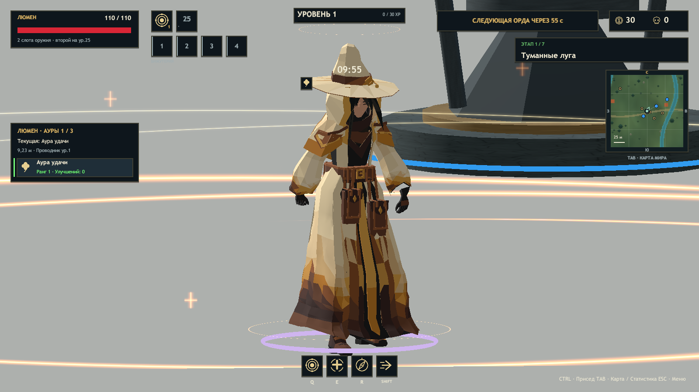
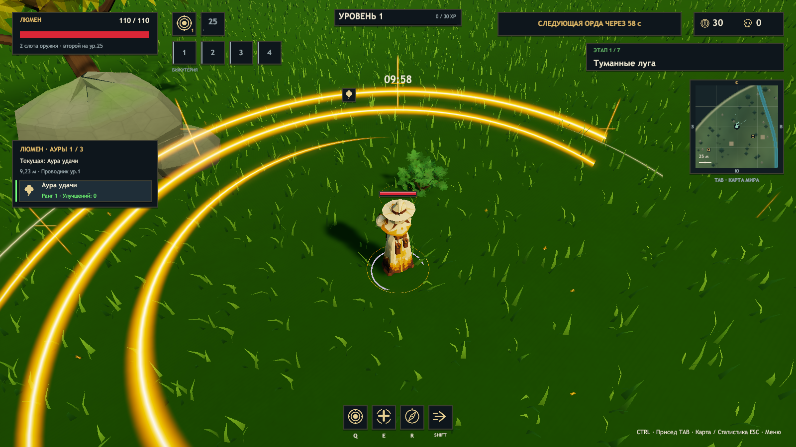

# ERA 0.28 — результаты проверки

Основа: `1972f63` / v0.27.0. Unity 2023.1.22f1, Blender 5.2.3 LTS, Windows x64. Финальная сборка успешна: **75 012 проверок**, `ERA_BUILD_OK 770667781 bytes`. [Машинный отчёт и SHA-256](polish-validation-v028.json) содержит десять свежих отчётов Player из восьми сценариев.

## Текст в настоящем интерфейсе

`HudTextLayout` измеряет строки через `GUIStyle.CalcSize` с тем же шрифтом, размером и начертанием, которыми они отображаются. Проверяются описания всех восьми аур на RU/EN. Раскладка кэшируется; при перестройке атласа шрифта кэш очищается.

`Test-Polish.ps1 -Visible` открывает обычное окно Player и сохраняет кадры настоящего OnGUI из экранного буфера: русский, английский и компактный сетевой вид. На **53 228 проверенных отрисовках строк** найдено **0 выходов текста за ширину или высоту блока**. Проверяются также инвентарь и HUD. Проверка метрик включена только в диагностике. Скрытое окно Unity не обновляет настоящий OnGUI, поэтому для этой проверки нужен `-Visible`; отдельный служебный рендер интерфейса не считается доказательством.

[Английский интерфейс](Polish-v028/Native-English-cards.png) · [Компактные сетевые карточки](Polish-v028/Native-Online-cards.png). Сетевой вид здесь переключён диагностикой без подключения; реальная синхронизация проверена отдельно тремя процессами.

## Руки и шаги

Сохранён отдельный [исходник V12](../ArtSource/Characters/AuraWeaver/ReleaseV12/README.md). Геометрия и rest skeleton V11 сохранены; заменены только Walk и Run. Девять остальных Actions совпадают по контрольным суммам. Модель содержит 90 костей, 26 мешей, 12 966 треугольников и 11 клипов.

Проверка деформированных подошв в Blender дала высоту опорной подошвы около −6,4 мм для обоих циклов, в пределах допуска ±12 мм. Это измерение опорной фазы исходника; оно не проверяет каждый возможный уклон игрового рельефа.

В Player все 11 клипов назначены, проигрываются и дают конечную деформацию. В восьми фазах `Test-LumenMotion` проверены ходьба, ускорение, боковое движение, прыжок, рывок, шляпа и руки. В Walk/Run оба соответствующих веса достигают 1,0. Продольный ход обеих кистей — 0,63–0,66 м; статическая поза удержания руны при обычном движении устранена. После увеличения геометрического зазора мантии измеренное проникновение капсул ног в проверенных вершинах и центрах треугольников равно 0; порог проверки не ослаблялся.

[Другая фаза шага](Polish-v028/Walk-1.png) · [Ускоренный бег](Polish-v028/BoostRun-0.png).

## Видимая аура

Золотые дуги, встречные потоки, лучи и искры видны на игровой карте. Диагностика подтвердила радиус, следование отображаемой позиции модели, остановку времени эффекта на одиночной паузе и удаление после забега. Шейдер включён в сборку явно.

Эффект использует три общих статических меша, один общий материал и один небольшой динамический меш искр на героя: **8 рендереров и 1518 вершин**. Нет источников света, физических объектов или систем частиц. Это ограничение объёма эффекта; оно не является обещанием одинакового FPS на любом ПК.

[Усиление и увеличенный радиус](Polish-v028/Aura-surge.png) · [Аура при движении](Polish-v028/Aura-moving.png).

## Регрессии и FPS

На четырёх контролируемых маршрутах Люмена без лимита измерено 134,6–135,7 FPS. Остановок модели и полоски HP между шагами симуляции — 0, расхождение их опор — 0. Этот маршрут использует облегчённый тестовый графический режим и отключённые атаки/ауру; результат подтверждает интерполяцию при измеренной частоте, а не производительность полноценного боя с эффектами.

Проверки четырёх слотов бижутерии, роста уровней, максимума трёх аур, нового забега, соло, паузы и семи миров с боссами прошли. Кооператив на localhost в трёх отдельных процессах подтвердил `players=3`, `auras=true`, `accessories=true`, `secondWeapons=true`, `difficulty=true` у хоста и обоих клиентов. Протокол — 18. В графических логах исключений, ошибок компиляции шейдеров или загрузки ресурсов не найдено. WAN, отдельные физические ПК и длительный ручной баланс не проверялись.

Повторение: `Tools/Build.ps1`, `Tools/Test-LumenMotion.ps1`, `Tools/Test-Polish.ps1 -Visible`, `Tools/Test-Lumen.ps1`, `Tools/Test-CameraMotion.ps1 -Hero Lumen -Fps 0`, `Tools/Test-Accessories.ps1`, `Tools/Test-Solo.ps1`, `Tools/Test-Campaign.ps1`, `Tools/Test-Coop.ps1 -ThreeProcesses -Headless`, затем `Tools/Collect-PolishValidation.ps1`.
