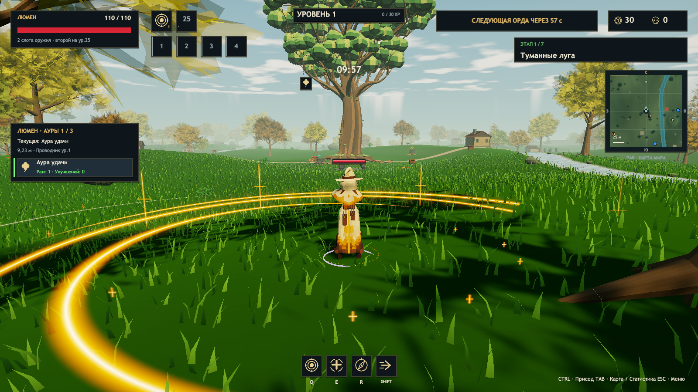

# Проверки ERA v0.29.0

Основа — актуальный main `ce8526e` с изменениями v0.27/v0.28. Unity 2023.1.22f1, Windows x64. Финальная сборка успешна; редактор выполнил 75012 проверок и дополнительные проверки дерева, коллизии, святилища, появления игроков и трёх LOD во всех семи мирах.

## Иггдрасиль в готовом Player

| Мир | Высота / крона, м | Листва на видимом небе | Центр / один экземпляр / LOD |
|---|---|---|---|
| 1 | 52.0 / 48.1 | 14.14% | Да / да / 3 |
| 2 | 52.0 / 48.1 | 0.17% | Да / да / 3 |
| 3 | 52.0 / 48.1 | 0.08% | Да / да / 3 |
| 4 | 52.0 / 48.1 | 0.08% | Да / да / 3 |
| 5 | 52.0 / 48.1 | 0.00% | Да / да / 3 |
| 6 | 52.0 / 48.1 | 0.47% | Да / да / 3 |
| 7 | 52.0 / 48.1 | 0.18% | Да / да / 3 |

Расположение — X=0, Z=0, уровень основания берётся из WorldMap. Крона занимает около 8% диаметра карты (48 / 600 м). Центральный каменный круг перемещён на Z=-24; случайные старты и статуя босса остаются в безопасных местах.

[Мир 2](WorldTree-v029/World-2-gameplay.png) · [3](WorldTree-v029/World-3-gameplay.png) · [4](WorldTree-v029/World-4-gameplay.png) · [5](WorldTree-v029/World-5-gameplay.png) · [6](WorldTree-v029/World-6-gameplay.png) · [7](WorldTree-v029/World-7-gameplay.png).

Метод оценки неба: отдельные replacement-маски листвы и сцены без мирового дерева, верхняя половина кадра, игровая камера с персонажем в 90 м от центра и pitch=8°. Это доля листвы поверх иначе видимого неба в конкретном ракурсе; маска не содержит HUD. Близкие обычные деревья, рельеф и угол камеры влияют на результат. Не заявляется гарантия для всех точек карты или взгляда строго вверх под кроной.

## Производительность и совместимость

Короткий последовательный замер после прогрева при лимите 150 FPS: с деревом **149.38 FPS**, без дерева **149.06 FPS**. Разница находится в шуме данного замера. Это автоматический режим с отключённым AA и уменьшенной дальностью теней, без полной боевой нагрузки; тест не является аппаратной гарантией и не заменяет замер обычных пользовательских настроек.

Кампания: семь миров, семь боссов, шесть переходов; существующий тест завершён успешно. Люмен: живой игровой экземпляр, Generic Avatar и все 11 анимаций проверены существующим Test-Lumen. Последние клипы V12, золотая аура, бижутерия и изменения другого разработчика сохранены. Сравнение контроллера подтвердило одинаковые состояния, клипы, переходы и условия при изменении только локальных сериализованных ID; лишняя перегенерация не включена в коммит.

Дополнительный Test-Polish в скрытом окне подтвердил ауру, диапазон, следование, паузу, очистку и отсутствие ошибок, но проверка OS/native screenshots получила пустые изображения и **не прошла**. Она не выдаётся за успешную проверку нативного UI. Изменений UI в этом задании нет. Дублирующие overview-файлы не используются как доказательство отдельного ракурса; опубликованы настоящие gameplay-кадры.

## Библиотека и пакет

Player BuildReport: 0 исходных ассетов, ни одной библиотеки CharacterFactory, `.blend` или Python-исходника. В `Resources/Characters/Library` остаются необходимые игровые ассеты; это не библиотека инструментов создания персонажей.

Расширенная библиотека находится вне проекта: `C:/Users/kolon/Documents/Codex/ERA-Character-Library`. Последние модели V11/V12 и снимок их интеграции дополнительно скопированы в `Snapshots/v0.28.0-ce8526e`, проверены SHA-256. Игровой ZIP собирается по списку разрешённых runtime-файлов; архивные отчёты, рендеры и исходники туда не копируются. После упаковки Verify-Package сверяет SHA-256 каждого игрового файла с протестированным Player и запрещает авторские исходники.

## Ограничения

- Отдельный ствол блокирует перемещение в общей симуляции; наружные прижатые к земле корни декоративные и не имеют точной полигональной коллизии.
- Подгонка корней — локальные копии на клиенте; исходные FBX не перезаписываются. Ветер и физика ветвей не добавлялись.
- Форма дальних LOD упрощена; арт-проверка текущих кадров не сертифицирует все ракурсы и разрешения.
- Исходная модель дерева и библиотека персонажей сохраняются локально. Полезная документация остаётся в GitHub, но не дублируется целиком в Windows ZIP.
