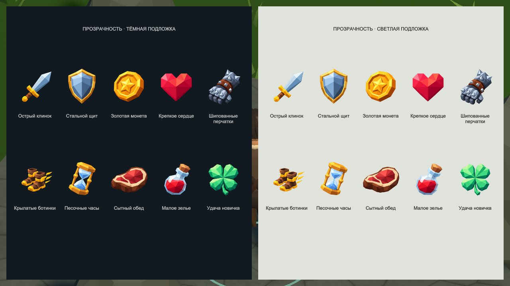
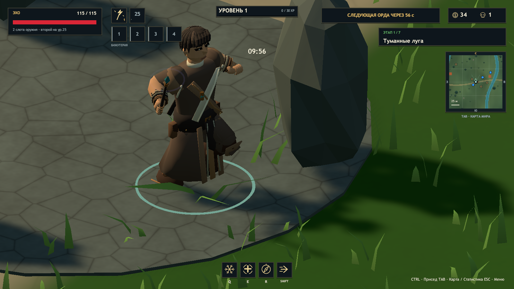
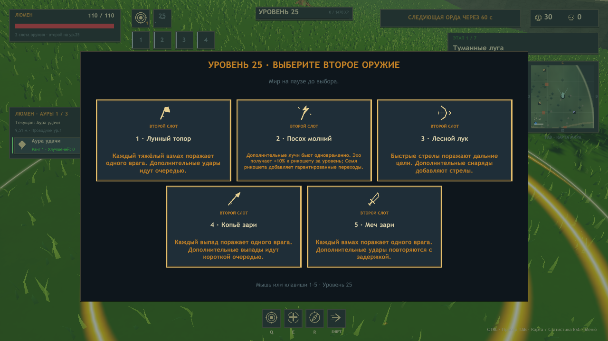

# ERA 0.29 — результаты проверки

Основа — `ce8526e` / v0.28.0. Unity 2023.1.22f1, Blender 5.2.3 LTS, Windows x64. Итоговая сборка успешна: **75 150 проверок**, `ERA_BUILD_OK 773643005 bytes`. [Машинный отчёт, SHA-256 и свежие результаты Player](update-validation-v029.json).

## Десять присланных иконок

Каждое изображение обработано отдельным запросом встроенного imagegen. Сохранены оригиналы и контрольные суммы; [запросы, PNG и описание импорта](../ArtSource/Items/v0.29/README.md). В Unity удалён остаточный альфа-шум до 4/255, внешний отступ в 3 px полностью прозрачен. Итоговые игровые PNG 256 × 256 сохранены отдельно в `ArtSource/Items/v0.29/Runtime`. Эти десять ID используют новые текстуры во всех местах отображения предметов; остальные ID сохраняют изображения v0.25.

Редакторские проверки сверяют SHA-256 выбранных PNG, размер, альфу, видимый объект, отсутствие обрезанного силуэта и правильный ID. `Test-ItemArt` подтвердил 129 разных картинок для 116 доступных и 13 зарезервированных ID, прозрачность, спрайты, все варианты вылета, цвета редкости, подбор, снимок состояния, каталог и ограниченный объём эффектов. Ошибок — 0.

## Собственная модель Эхо и палочка

Взята собственная модель Earthbound Monk v19; модель Люмена не копировалась. Новый отдельный исходник содержит 7524 треугольника и 121 игровую деталь. Rest matrices и bind positions совпадают с v19; контрольная сумма исходной мастерской не изменилась. [Исходники, экспорт и ракурсы](../ArtSource/Characters/Echo/ReleaseV29/README.md).

В Player проверены стояние, ходьба, бег, заклинание, приседание и прыжок. За 213 кадров движения ход левой/правой ладони составил 0,593 / 0,591 м. Палочка видна с начала забега и использует одноручный профиль; максимальная ошибка привязки к ладони — менее 0,000001 м. Деформированные вершины конечны, без взрывов геометрии. Это проверка конкретных поз и хвата, не полноценный решатель столкновений ткани во всех возможных состояниях.

[Стояние](Update-v029/Echo-idle.png) · [Бег](Update-v029/Echo-run.png) · [Заклинание](Update-v029/Echo-cast.png) · [Приседание](Update-v029/Echo-crouch.png) · [Прыжок](Update-v029/Echo-jump.png) · [Студийный вид](Update-v029/character-Echo-v016.png).

`Test-Characters` подтвердил семь моделей, скины, клипы и приседание. `Test-Rig` проверил 108 сочетаний героя, оружия и позы, включая палочку Эхо и оба прежних героя; контролируются точки хвата, конечная деформация, Generic-анимации лучника и физические капсулы. [Палочка и прежнее оружие союзников](Update-v029/grip-LightningStaff-v019.png).

## Выбор оружия на 25-м уровне

`UpgradeChecks` получает настоящие предложения через повышение уровня, выбирает каждую допустимую позицию для каждого героя и проверяет второй слот. Пятый вариант Люмена принимается; обычный выбор бижутерии остаётся доступным. Раскладка проверяется на видимость всех карточек, нахождение внутри окна и отсутствие пересечений с другими карточками и подсказкой. Обычный ввод содержит один обработчик цифровых клавиш.

`Test-Update29 -Visible` проверил русский и английский виды Люмена, все четыре варианта Эхо и лучника, а также компактные сетевые карточки. Сохранены семь кадров настоящего экранного буфера, включая галерею иконок. За **67 336 проверенных отрисовок строк** — **0 выходов за границы текста**. Пятый вариант дополнительно выбран через обычный `GameApp.Choose` с подтверждением второго слота. Все флаги отчёта `true`, ошибок — 0.

[Английский](Update-v029/Weapons-Lumen-EN.png) · [Эхо](Update-v029/Weapons-Echo-RU.png) · [Лучник](Update-v029/Weapons-Ember-RU.png) · [Компактный сетевой RU](Update-v029/Weapons-Online-RU.png) · [Компактный сетевой EN](Update-v029/Weapons-Online-EN.png) · [После выбора пятого оружия](Update-v029/Choose-fifth.png).

## Регрессии и границы проверки

Итоговый комплект содержит десять сценариев и двенадцать свежих отчётов Player. Проверены анимации и очистка эффектов при 90 врагах / 384 снарядах / 320 эффектах, пауза, прежняя золотая аура Люмена, карточки аур, четыре слота бижутерии, одиночный забег и семь миров. Кооператив проверен тремя отдельными процессами на localhost: `players=3`, `auras=true`, `accessories=true`, `secondWeapons=true`, `difficulty=true` у хоста и обоих клиентов. Протокол — 18.

В финальных графических логах нет исключений, ошибок компиляции шейдеров или загрузки ресурсов. Отдельные физические ПК, WAN, длительный ручной баланс и гарантированный FPS на другом оборудовании не проверялись. Изображения окна выбора оружия в сетевом стиле снимаются без подключения; синхронизация отдельно проверяется трёхпроцессным сценарием.

Повторение: `Tools/Build.ps1`, `Tools/Test-Update29.ps1 -Visible`, `Tools/Test-ItemArt.ps1`, `Tools/Test-Characters.ps1`, `Tools/Test-Rig.ps1`, `Tools/Test-Animation.ps1`, `Tools/Test-Polish.ps1 -Visible`, `Tools/Test-Accessories.ps1`, `Tools/Test-Solo.ps1`, `Tools/Test-Campaign.ps1`, `Tools/Test-Coop.ps1 -ThreeProcesses -Headless`, затем `Tools/Collect-Update29Validation.ps1`.
