# ERA: Seven Realms — v0.29.2

**[Скачать ERA v0.29.2 для Windows — Era-Windows.zip](https://github.com/Regardov/Era/releases/download/v0.29.2/Era-Windows.zip)** · [Страница релиза](https://github.com/Regardov/Era/releases/tag/v0.29.2). Распакуйте архив целиком и запустите `Era.exe`.

**v0.29.2:** исправлены столкновения с широким основанием и крупными корнями Иггдрасиля. Камера теперь наклоняется вокруг персонажа. Подключён каменный голем из локальной библиотеки: подъём обеих рук, удар в землю и восстановление с привязкой к игровому урону. [Подробности и проверки](Docs/RELEASE-v0.29.2.md).

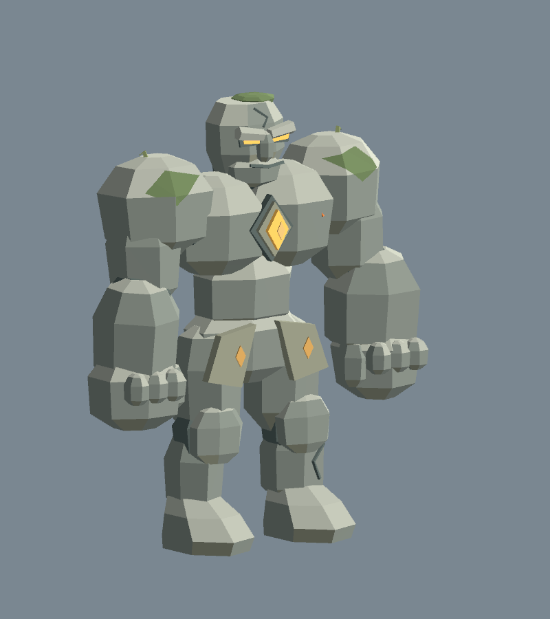

**Сохранено из v0.29.1:** Иггдрасиль втрое крупнее — 156 м высотой и около 144 м в ширину; взгляд вверх до −75°, три LOD и дальность камеры 520 м. Библиотека персонажей остаётся вне игры. [Изменения v0.29.1](Docs/RELEASE-v0.29.1.md).

**Сохранено из v0.29.0:** центральное дерево во всех семи мирах, подогнанные к рельефу корни, компактный игровой ZIP без исходников библиотеки. [Предыдущие изменения](Docs/RELEASE-v0.29.0.md) · [Проверки v0.29.0](Docs/VALIDATION-v0.29.md).

**В текущих исходниках v0.28:** исправленные переносы текста в карточках, новые шаги и свободное движение рук Люмена V12, видимая золотая аура с вращающимися дугами, лучами, искрами и нимбом. [Изменения](Docs/UPDATE-v0.28.md) · [Проверки и игровые кадры](Docs/VALIDATION-v0.28.md) · [Blender V12](ArtSource/Characters/AuraWeaver/ReleaseV12/README.md). Сборка из исходников: `Tools/Build.ps1`.

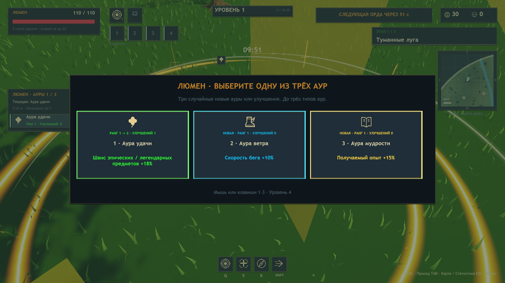

**Сохранено из v0.27:** четыре постоянных слота бижутерии с растущими уровнями, максимум три ауры Люмена, плавная полоска HP над персонажем и выбор лимита FPS, включая режим без лимита. [Правила](Docs/UPDATE-v0.27.md) · [Проверки](Docs/VALIDATION-v0.27.md).

**[Исторический Windows-архив: v0.26.1 — Era-Windows.zip](https://github.com/Regardov/Era/releases/download/v0.26.1/Era-Windows.zip)** · [Страница релиза](https://github.com/Regardov/Era/releases/tag/v0.26.1). Изменения v0.28 также входят в актуальный Windows-релиз.

**v0.26.1 — исправления Люмена:** янтарная руна у ладоней вместо старого зелёного Aura-фокуса, разные походки и наклон корпуса, коррекция мантии по ногам, непрозрачная замкнутая шляпа с плавным кончиком и приподнятые передние сумки. [Изменения](Docs/RELEASE-v0.26.1.md) · [Проверки и игровые кадры](Docs/VALIDATION-v0.26.1.md) · [Blender V10](ArtSource/Characters/AuraWeaver/ReleaseV10/README.md).

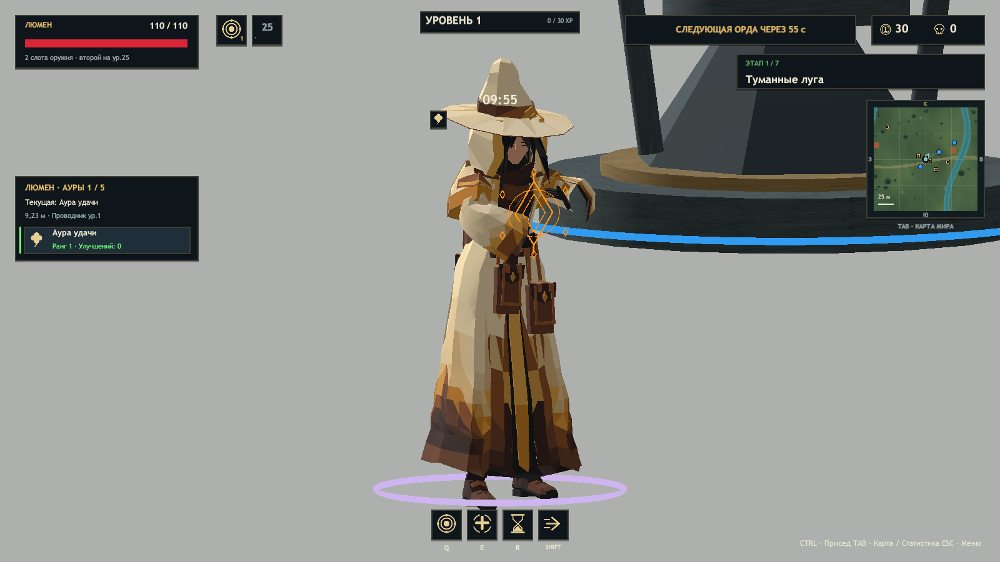

**v0.26.0 — новая внешность Люмена: Aura Weaver.** Янтарная мантия с рисунком 09, закрытый капюшон, шляпа с объёмным хвостом под 30° от направления назад, перчатки, каблуки и закреплённые сумки. Под текущие пропорции адаптирован отдельный Generic-риг и 11 клипов движения, магии, урона и смерти. Его способности, ауры и баланс сохранены; модель лучника не заменяется. [Изменения](Docs/RELEASE-v0.26.0.md) · [Проверки и кадры игры](Docs/VALIDATION-v0.26.md) · [Blender/FBX V9](ArtSource/Characters/AuraWeaver/ReleaseV9/README.md).

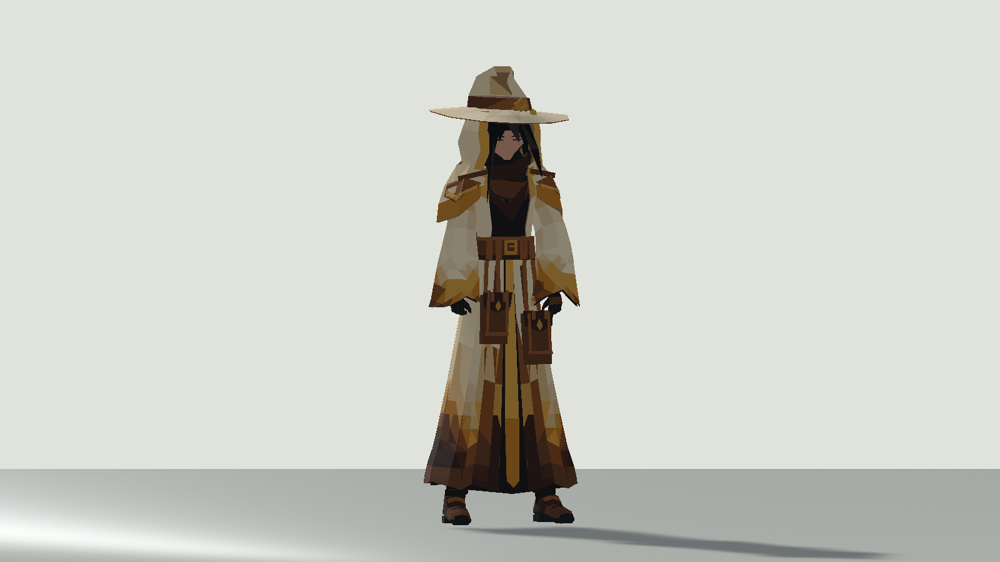

**v0.25.1 — устранены рывки самого лучника при высоком FPS.** Модель и камера используют одну интерполированную позицию между шагами симуляции 30 Гц. Убрана принудительная постановка модели в ступенчатую координату; на сетевом клиенте сохранено сглаживание снимков. Анимационные клипы, частота симуляции, урон, баланс и предметы v0.25 сохранены. [Изменения](Docs/RELEASE-v0.25.1.md) · [Проверки FPS и сборки](Docs/VALIDATION-v0.25.1.md).

**Новое v0.25:** отдельные прозрачные иллюстрации всех предметов — 129 PNG и SVG для 116 доступных и 13 зарезервированных ID. Новые изображения используются во всём интерфейсе и на земле. Пять анимаций вылета из сундука, цветное свечение по редкости: зелёное → синее → фиолетовое → малиновое → золотое. [Изменения](Docs/RELEASE-v0.25.0.md) · [Все исходники рисунков](ArtSource/Items/v0.25/README.md) · [Проверки и кадры](Docs/VALIDATION-v0.25.md).

**Новое v0.24:** из редкого тира исключены 13 из 23 предметов; осталось 10 полезных вариантов. В каталоге и выпадении **116 предметов**. Перебалансированы 28 эффектов/описаний всех тиров: слабые находки усилены, чрезмерные повторы ограничены. В каждом мире **30 сундуков** (24 обычных + 6 лунных; бесплатная награда стражей отдельно), базовая скорость всех героев **+6%**. [Изменения](Docs/RELEASE-v0.24.0.md) · [Актуальный каталог](Docs/ITEMS-v0.25.md) · [Проверки](Docs/VALIDATION-v0.24.md).

**v0.23.2 — исправлены постоянные рывки камеры при движении лучника.** Цель камеры теперь плавно интерполируется между шагами симуляции 30 Гц. Камера больше не поворачивается рывками вслед за дискретной координатой модели; положение лучника и точка выпуска стрелы сохранены. Модель, анимационные клипы, баланс и механики v0.23.1 сохранены. Пробная новая модель Люмина в игру не добавлялась.

[Изменения v0.23.2](Docs/RELEASE-v0.23.2.md) · [Проверки камеры и сборки](Docs/VALIDATION-v0.23.2.md). Для кооператива используйте v0.25.1 на всех ПК.

**v0.23.1 — обновлённые анимации в готовой Windows-игре.** У лучника 26 клипов, отдельные фазы прыжка/падения/приземления, бег с кастом и стрельбой, уточнённые Idle и действия, включённое падение при смерти. Нижние секции плаща двигаются с запаздыванием; у врагов сглажен переход замах → удар, стрела летит без декоративного покачивания. Сохранены все пассивки, ауры, окружение, баланс, семь миров и кооператив v0.23.

[Изменения v0.23.1](Docs/RELEASE-v0.23.1.md) · [Проверки сборки](Docs/VALIDATION-v0.23.1.md) · [Анимационный аудит и оставшиеся ограничения](Docs/ANIMATION-QUALITY-AUDIT.md) · [Видео до/после](Docs/AnimationQuality/Video). Для запуска достаточно распаковать архив целиком; Unity и Blender не требуются.

В исходниках также доступна [ERA Character Factory](ERA_CHARACTER_WORKFLOW.md): библиотека компонентов Blender, измеренный Style Guide и инструменты для будущих персонажей.

[Aura Weaver](ArtSource/Characters/AuraWeaver/README.md) развивался как отдельный ассет; с v0.26.0 версия V9 используется как внешность существующего Люмена. Новая механика аур или отдельный класс не добавлялись.


**v0.23 объединяет все завершённые изменения `main` и `codex/autumn-passives-auras`.** В одной игре: обновлённые движения лучника и стрельба на ходу, инерция плаща/колчана, новые пассивки и три случайные ауры Люмена, домики и руины, осенние листья со случайным лутом, пышная полупрозрачная листва, −8% HP обычных мобов и +12 базового урона оружия/Q лучнику и Эхо. Урон Люмена сохранён. Базовые ОЗ семи боссов: **2500 / 5000 / 5500 / 6500 / 7500 / 10000 / 12000**.

[Изменения v0.23](Docs/RELEASE-v0.23.0.md) · [Проверки объединённой сборки](Docs/VALIDATION-v0.23.md) · [Движение лучника](Docs/ARCHER-MOTION.md).

В опубликованной v0.23 у лучника 22 клипа: перенос веса и работа плеч при беге, боковое и обратное движение, прицеливание/натяжение/выпуск поверх locomotion, повороты корпуса и инерция экипировки. Внешность и материалы сохранены. [Исходные изменения движения](Docs/RELEASE-v0.22.0.md).

**Включено в v0.23.1:** 26 клипов лучника, отдельные JumpStart / Airborne / Fall / Land, переработанные шаги и контакт стоп с землёй, более объёмный лук и трапециевидный колчан. [Проверки, ограничения и четыре коротких видео](Docs/ARCHER-REFINEMENT.md).

**Улучшения качества анимаций v0.23.1:** Cast/Hit/Interact лучника смешиваются с бегом отдельным слоем, включено авторское падение при смерти, уточнены Idle и пять существующих действий, плащ получил запаздывание нижних секций. У остальных актёров сглажен переход замах → удар, исправлено движение ткани при шаге; стрела летит без декоративного покачивания, у призванного дрона работают крылья. [Аудит каждого клипа, runtime-проверки и оставшиеся дефекты](Docs/ANIMATION-QUALITY-AUDIT.md) · [Короткие видео до/после](Docs/AnimationQuality/Video).

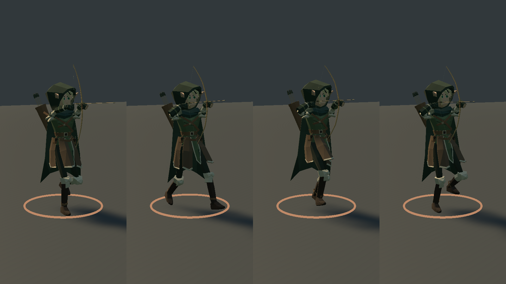

В v0.22.1 кроны стали пышными и полупрозрачными: вместо сплошных объёмов — больше отдельных листьев с непрозрачностью 58%. Здоровье обычных мобов уменьшено на 8%. Лучник и Эхо получили +12 к базовому урону оружия и Q до множителей; у Люмена прежний урон. [Проверки и кадры v0.22.1](Docs/VALIDATION-v0.22.1.md).

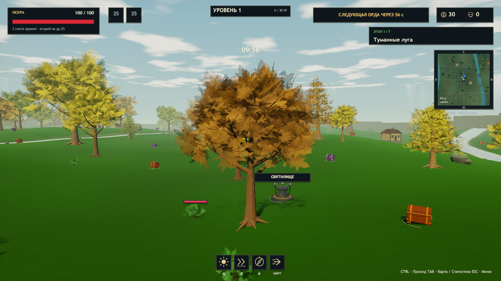

В v0.22 добавлены пассивки за повышение уровня: **лучнику +3 п.п. шанса крита**, **Эхо +10% к рикошету молний оружия**, **Люмину +3% к радиусу аур**. У Эхо каждые полные 100% дают гарантированный переход, остаток — шанс следующего: 230% = 2 перехода + 30% на третий. У Люмина на каждом уровне после аксессуара появляется **три случайных варианта** новых аур или улучшений изученных; в v0.27 лимит составляет три типа. Бонусы начисляются сразу при получении уровня, независимо от завершения выбора. Базовые параметры героев сохранены.

Видеокарты заменены **72 кучками осенних листьев**: золото или опыт выбираются случайно при разрушении с равными шансами; оттенок листьев не сообщает награду. По всем семи картам расставлены домики и руины, деревья получили резные листья с прожилками и более разнообразную осеннюю палитру. Строения учитываются в общей коллизии, размещении объектов и карте Tab.

Локальная сборка: `Builds/Windows/Era.exe`; исходники открываются в Unity **2023.1.22f1**. Итоговые проверки: [v0.23.2](Docs/VALIDATION-v0.23.2.md).

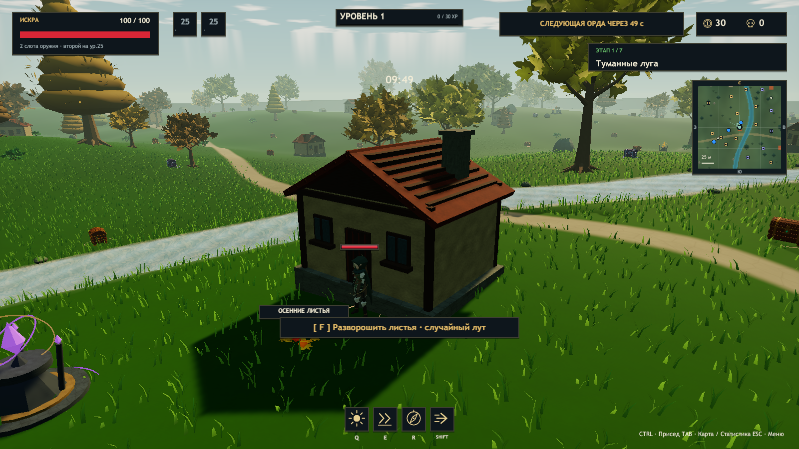


**v0.21 восстанавливает анимации обновлённого лучника в Windows-игре.** Исправлен прежний импортёр: редакторские `PreviewAnimationClip` заменены настоящими runtime-клипами с сохранением GUID. Модель, 54-костный Generic-риг и 16 авторских Actions восстановлены без повторного моделирования и создания движений. В собранном Player проверяются реальные движения костей, события и игровые снаряды. Автовыстрел больше не теряет release-позу при заклинании. Все изменения v0.20 сохранены.

**[Причина сбоя и восстановление](Docs/ARCHER-RECOVERY-v0.21.md)** · **[Проверки и ограничения](Docs/VALIDATION-v0.21.md)** · **[Исходник Blender и клипы](ArtSource/Characters/Archer/README.md)**. Вспомогательные клипы импортированы и проверены технически; DodgeRoll и Death остаются художественными черновиками, полноценное падение при смерти по умолчанию выключено.

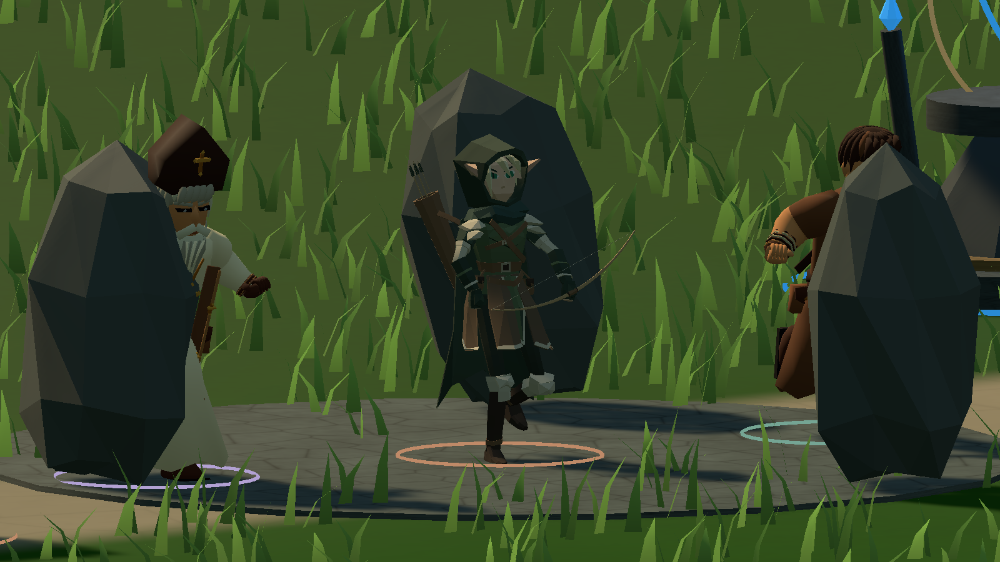

В текущих исходниках обновлено окружение: прозрачные ручьи с преломлением, галечным дном и мягкими бликами; разветвлённые деревья с отдельными колышущимися листьями и хвойными кронами. Справа в игре появилась **квадратная миникарта ближайшей местности**, а Tab открывает квадратную карту всего мира с реками, рельефом и живыми маркерами. [Описание и проверка окружения](Docs/ENVIRONMENT-POLISH.md).

Добавлен новый саундтрек: **отдельная композиция меню и семь тем миров**, всего 15 минут музыки с семплированными инструментами, развитием аранжировок и зацикливанием. Между треками — плавные переходы; на паузе музыка приглушается. [Превью, список треков и MIDI](ArtSource/Music/README.md) · [Воспроизведение и проверки](Docs/MUSIC.md).

В v0.20 исправлена замкнутая геометрия стволов и добавлены густые объёмные кроны. Вместо декоративных кругов предметов — огонь, лёд, яд, разряды, духи, мины, метеоры и эффекты действительного лечения, щита и ускорения. Звуки атак и статусов пространственные, с ограничением повторов и голосов. Обычный прыжок больше не позволяет перескочить врага; головы врагов не служат опорой. [Аудит всех 129 предметов и остальных механик](Docs/MECHANIC-FEEDBACK-AUDIT.md) · [Проверки и список изменённых файлов](Docs/FEEDBACK-VALIDATION.md). Windows-сборка v0.21 включает эти изменения.

Новое в v0.19: столкновения капсул игрока и врагов на хосте, скольжение вдоль тел, разделение толпы и учёт высоты прыжка. Семь моделей переработаны в Blender: сглаженные органические поверхности, объёмные пряди, закрытые рукава, толщина одежды и исправленные веса. Шесть видов оружия получили собственные меши, настраиваемые точки хвата, привязку к ладони и IK второй руки.

**[Изменения и устройство систем v0.19](Docs/CHARACTER-BODY-v0.19.md)** · **[Проверки v0.19](Docs/VALIDATION-v0.19.md)** · **[Исходники Blender](ArtSource/Characters/README.md)**.

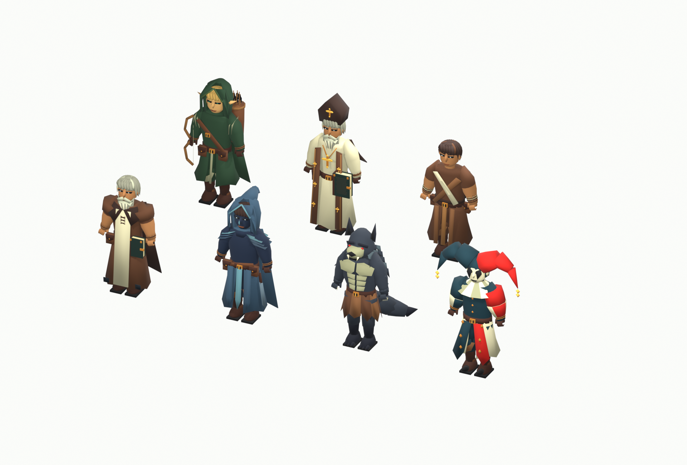

Новое в v0.18: плавные анимации героев и 16 типов врагов, фазы атак боссов, собственные движения оружия и стрел, эффекты способностей, сундуков, лута и окружения, плавный HUD и настройка интенсивности эффектов. Баланс v0.17 сохранён.

**[Аудит и реализация](Docs/ANIMATION-AUDIT-v0.18.md)** · **[Проверки v0.18](Docs/VALIDATION-v0.18.md)**.

Новое в v0.17: присед с коленями вперёд и опорой стоп, цельные причёски, случайные безопасные точки появления команды и статуи босса. Базовые ОЗ боссов: **10 000 / 25 000 / 50 000 / 100 000 / 200 000 / 400 000 / 800 000**; множитель команды сохранён. Обычный сундук от 10 золота, лунный от 30. Между волнами интервал спавна увеличен на 10%. Опыт до следующего уровня: `30 + 12 × (уровень − 1) + 2 × (уровень − 1)²`; остаток сохраняется, опыт общий. Каменная площадка поднята над землёй для устранения мерцания.

**[Изменения v0.17](Docs/RELEASE-v0.17.0.md)** · **[Проверки v0.17](Docs/VALIDATION-v0.17.md)**.

Новое в v0.16: **семь моделей, созданных в Blender по референсам**. Искра — эльф-следопыт, Эхо — монах, Люмен — прелат; преследователь — оборотень, огонёк — шут. Седой странник и маг в синем капюшоне добавлены в библиотеку префабов. У моделей редактируемые детали костюмов, материалы, арматуры и веса. Игровые анимации сохранены.

**[Исходник Blender, FBX и инструкция](ArtSource/Characters/README.md)** · **[Изменения v0.16](Docs/RELEASE-v0.16.0.md)** · **[Проверки v0.16](Docs/VALIDATION-v0.16.md)**.

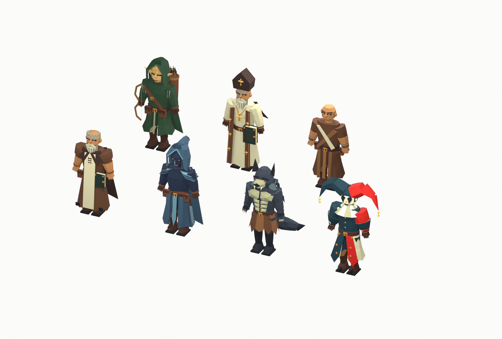

Новое в v0.15: **120 иконок из предоставленных изображений**, ручьи, пригорки, кусты, крупные деревья и трава из изогнутых травинок. Панель уровня вдвое тоньше, полоса босса выше. Каждый дополнительный игрок даёт **×2 спавн / ОЗ / урон** (трое — ×4). После босса орда продолжает идти ещё вдвое чаще, а ОЗ и урон врагов растут на **10% каждые 10 секунд** до перехода в следующий мир.

У необычных предметов и аксессуаров **процентные бонусы выше 10% уменьшены вдвое**. «Вампирский клык» удалён: в каталоге главного меню и Tab теперь **116 предметов**. Максимальные ОЗ обычных мобов растут **×1,5 за каждый новый мир**; у боссов новая шкала v0.23. Цены 30 сундуков на мир продолжают расти по ×5/3 на протяжении всего забега и не сбрасываются при переходе.

Золото сразу поступает в общий кошелёк; опыт подбирается кристаллами. Прицел убран. Полоса босса показывает текущие и максимальные ОЗ; босс имеет иммунитет к статусам и контролю, сохраняя уязвимость к прямому урону.

**[Изменения v0.15](Docs/RELEASE-v0.15.0.md)** · **[Каталог предметов](Docs/ITEMS-v0.25.md)** · **[Проверки](Docs/VALIDATION-v0.15.md)**.

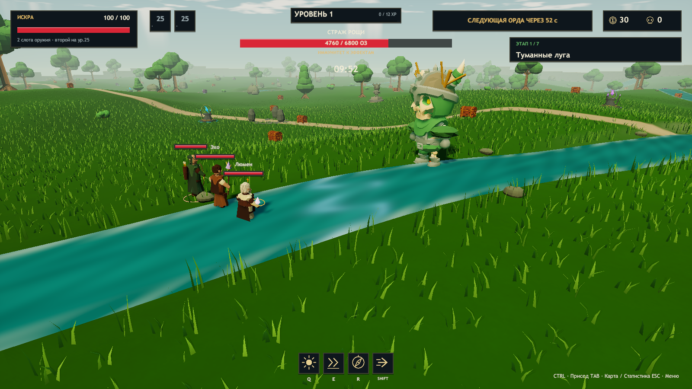

Предметы поддерживают статусные синергии, призыв помощников и рост за действия в забеге. Два дабл-шота дают три выстрела; посох выпускает весь залп одновременно, меч и копьё — очередью с интервалом `0.75 / 1.5^(N - 2)` при `N ≥ 2`. Обычный снаряд поражает одну цель; «Семя рикошета» добавляет переходы в новые цели с 65% предыдущего урона. Вампиризм — шанс базового лечения за удар; выше 100% повышается количество ХП. Уклонение накапливается от оставшейся вероятности и ограничено 95%. Щит и уклонения отображаются явно, подсказки характеристик — поверх карточек.

## Скачать готовую игру для Windows

**[Последний релиз → Assets → Era-Windows.zip](https://github.com/Regardov/Era/releases/latest)**. Распакуйте весь архив и запустите **Era.exe**. Устанавливать Unity не нужно.

Игра доступна всем: регистрация в GitHub и приглашение не нужны. **[Пошаговая инструкция для скачивания и кооператива](Docs/DOWNLOAD-RU.md)**. Кнопка **Code → Download ZIP** скачивает исходники, а готовая игра находится в **Releases**.

Рост цены v0.10 заменён в v0.13 формулой выше. Модели сундуков имеют планки, скобы, ручки, обивку и открывающуюся крышку. У Люмена в HUD, Tab и выборе аур показаны **ранг** и **число улучшений**; получение новой ауры не считается улучшением.

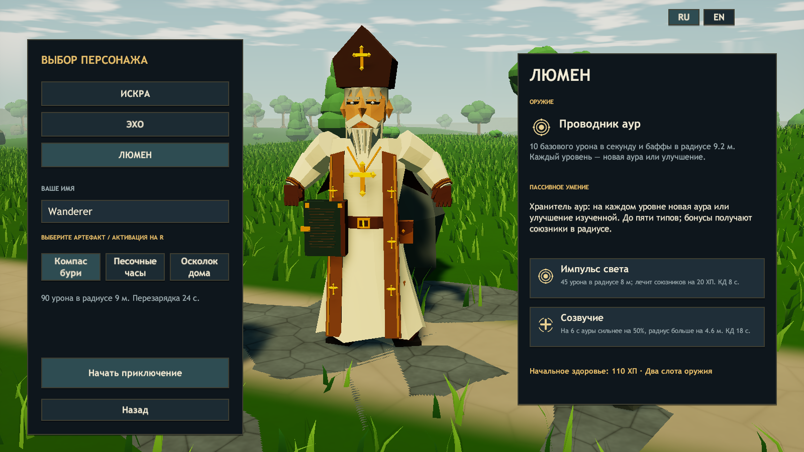

Unity **2023.1.22f1**, Windows. A third-person survivor for **1–3 players** with **seven realms**, seven different bosses, party portals, sculpted terrain, detailed bark/stone materials, reactive grass and the aura support hero **Lumen**. Russian / English interface, original music and sound effects.

## Open in Unity

Open this folder in Unity Hub using **Add → Add project from disk**, then use **2023.1.22f1**. Open **`Assets/Era/Scenes/Rift.unity`** and press **Play**. You can also run `Tools/Open-In-Hub.ps1`, `Tools/Open-Unity.ps1`, or choose **ERA → Open game scene** in the editor.

The **600 m wide first realm with hills is saved in the scene**, visible and editable before Play. The hierarchy separates terrain, chunked bark/foliage/rocks, reactive grass, landmarks and light. **ERA → Rebuild Stillwater map** regenerates it and replaces scene contents; preserve manual scene edits separately. Later realms are generated on entry from the shared stage ID. Only the current realm is active; generated meshes/materials are released when it is replaced.

The game creates its cameras, animated heroes, creatures, chests, HUD and audio systems when entering Play mode. Editable, runtime-used hero prefabs are in **`Assets/Era/Resources/Characters`**; creature prefabs are in **`Assets/Era/Resources/Creatures`**. Their joints and materials can be inspected in Prefab mode. No paid assets or third-party packages are required.

## Play without the editor

Run **`Builds/Windows/Era.exe`**. Choose **Play solo**, pick **Ember**, **Echo** or **Lumen**, choose a relic, enter a name and select **Begin the journey**.

To share the game, send **`Releases/Era-Windows.zip`** or the **whole `Builds/Windows` folder**. The executable needs its accompanying data folder and DLLs.

## Co-op for 2–3 players

1. Run the same v0.23.2 game version on all computers in the same **LAN or VPN**.
2. Choose **Play co-op · 2–3 players**. One player creates a lobby.
3. One or two friends choose **Join a lobby**, enter the host IP, choose heroes and connect.
4. Wait for the whole party, then **every connected player presses `I'm ready`**. A three-second countdown begins. A party of two can also start.
5. Selecting **Not ready yet** cancels the countdown. Character changes are available while unready; a player disconnecting also cancels the countdown.

The port is **TCP 7777**. Allow the game on your private network if Windows Firewall asks. Use `127.0.0.1` for copies on the same PC; use the host's actual LAN/VPN IP for different computers. There is no split screen, Steam lobby, Relay, host migration or automatic NAT traversal. Joining a run already in progress is not supported. Protocol 16 carries the curated item pool and new balance and is incompatible with older builds. All three players need the same build.

## Controls

| Input | Action |
|---|---|
| WASD / mouse | Move / look |
| Space | Jump; hold for a higher arc, release for a short hop |
| Shift | Dash with brief invulnerability |
| Hold Ctrl / C | Crouch and move quietly at 43% speed |
| Q / E | Character abilities |
| R | Use the selected active relic |
| F | Enter a nearby party portal, pick up a floor item, or open a chest |
| Hold F | Revive a nearby downed companion (2.5 s), or channel a nearby shrine (5 s) |
| 1–3 / mouse | Choose an accessory; second weapon choices appear at level 25 |
| 1–8 / mouse | Lumen's aura choices (only owned auras after five types) |
| Hold Alt | Show cursor |
| Tab | Map, chest items, rarity odds and all attributes |
| Esc | Pause / settings menu |
| Alt+F4 | Exit |

There are exactly **two weapon slots**: the hero's starting weapon and a second weapon chosen at **level 25**. Equipped attack weapons fire automatically; Lumen's Aura Conduit continuously buffs the party. Escape pauses solo play. Every solo level-up pauses until all its choices are made. Co-op never pauses for upgrades, including after a disconnect. Tab keeps the world moving. Switch RU / EN in the menu or Settings.

## The world and progression

Explore seven large rolling realms. Height, obstacles, chest/shrine positions and spawn ground all use the same deterministic stage-specific terrain function on host and guests. The arrival clearing is flat; hills and ridges surround it. Trees have tapered branching trunks, roots and layered crowns; rocks use fractured 512px albedo/normal maps and moss on top. Grass covers the realm in chunked meshes and bends away from the feet of all three players, then rises when they move or jump away. Distant grass is culled at 85 m. Press Tab for the map, treasure, enemies and party.

There are **30 chests per realm**, **30 starting shared gold**, and shared XP. The **level and XP bar are top-center**, above the two weapon slots. Health and both teammates appear on the left. Every successful hit displays damage; critical hits use larger gold numbers. Enemies flash and react to hits. Tab shows the map, items, accessory stacks, rarity odds and all **21 stats**.

Press **F** near a chest. In the first realm ordinary chests start at **10–18 gold**; **Moon chests start at 30** and have better rarity odds. A chest can only be opened once. Its actual item immediately appears on the floor and remains there until **any living player approaches within 2.5 m and presses F**. The first claim wins; a collector falling or disconnecting releases the item. Chests contain **116 items** in five rarity tiers and never unlock extra weapons. Luck improves rarity rolls.

Every level offers three **accessories** from a pool covering **21 stats**: damage, attack speed, critical chance/damage, max HP, healing, regeneration, shield, armor, lifesteal, movement, evasion, recharge speed, range, area, projectile count/speed, pickup range, luck, XP and gold gain. Examples: **Precision Ring**, **Life Amulet**, **Merchant's Purse**. Rarity sets the bonus: legendary Life Amulet gives +40 max HP; epic Precision Ring gives +15% crit chance. Accessories stack for the run. The level-25 weapon choice is additional to that level's accessory and remains queued correctly after multi-level XP gains.

Every realm starts with a ten-minute countdown. Ordinary enemies continuously arrive 12–19 m from living players. At each expired minute, an additional horde joins and the regular spawn interval becomes shorter; previous enemies do not need to die first. A short arrival warning and melee windup let players react. The live-enemy cap prevents unlimited accumulation, while distant ordinary enemies are recycled around the party. The countdown stops at zero and the final spawn pressure continues. The realm boss still appears when a living player presses **F at the stone boss statue**. Enemy HP/damage and boss strength increase with realm number and party size.

| Realm | Boss | Signature attack |
|---|---|---|
| Mistveil Meadows | Grove Warden | Delayed ground slam |
| Amberwood | Antlered Executioner | A line of fiery impacts |
| Azure Highlands | Glacial Oracle | Frost nova and aimed ice zones |
| Cinder Crags | Forge Colossus | Cross-shaped eruptions |
| Twilight Mire | Mire Matriarch | Persistent poisonous pools |
| Stormpass Citadel | Storm Paladin | Sequential lightning strikes |
| Heart of the Rift | Rift Sovereign | Radial ruptures and summoned stalkers |

After bosses 1–6 die, a **portal opens at the boss's position**. Existing enemies remain, spawning doubles, and current/max enemy HP and damage compound by 1.1 every 10 seconds until the party enters the portal. Any living player within 3.5 m can press **F** to move the **whole party** into the next realm. Gear, accessories, aura ranks, XP, gold and queued level choices are preserved. Everyone arrives together, healed and revived, with brief protection. Treasure, shrines, enemies and the stage timer reset. **Only the seventh boss completes the run.**

If a companion falls, approach within 3.5 m and hold F for 2.5 seconds. They have 25 seconds before bleeding out. Reviving restores half health and gives three seconds of protection. Everyone downed means defeat. A disconnected guest leaves the remaining party able to continue; losing the host returns guests to the menu. Each additional connected player doubles enemy HP, damage and spawn frequency: solo ×1, two players ×2, three players ×4. Downed players still count; disconnects rescale living enemies.

## Weapons, heroes, chest items and relics

**Weapons**: Crescent Axe cleaves an arc; Lightning Staff chains between enemies; Wildwood Bow fires arrows; Dawn Spear pierces in a line. Ember starts with a bow, Echo with a staff, Lumen with an Aura Conduit. At level 25 choose one different attack weapon. Book of Knowledge upgrades an equipped weapon up to level 5.

**Ember**: +3 percentage points of critical chance per level-up. 100 health, Sunburst (Q: 77 base damage in 7 m, 8 s cooldown), Overdrive (E: double fire rate and +30% movement for 6 s, 18 s cooldown).

**Echo**: +10% weapon lightning ricochet per level-up. Each full 100% guarantees an additional new target; the remainder rolls once for the next bounce. This adds to Ricochet Seed and keeps the existing 65% damage per transition. 115 health, 90% base damage, Frost Bloom (Q: 47 base damage and 3 s freeze in 8 m, 10 s cooldown), Resonance (E: restore 35 health and give 25 shield to both allies within 12 m, 16 s cooldown).

**Lumen**: 110 HP, an animated bearded aura keeper in an ivory robe with earth-toned mantle. Initial aura radius is **12 / 1.3 ≈ 9.23 m**, growing by **3% of base radius per level-up**. This affects the aura weapon and allied aura range, while ability radii retain their own scaling. The conduit deals **10 base damage per second** to enemies in range in four pulses, scaling with damage/crit/item modifiers. Starts with **Fortune Aura**. Every level grants an accessory and **one choice from three random distinct aura cards: upgrade an owned aura OR add a new buff aura**. Keep up to **five different types**. Repeated choices add 20% of base buff per rank; after five types the three cards are randomly drawn from owned upgrades. Auras affect the bearer and living allies, scale with range/area/conduit level, disappear outside range or when Lumen falls/disconnects, and use the strongest overlapping source.

| Aura | Rank 1 bonus |
|---|---|
| Fortune | +15% epic/legendary rarity weights |
| Might | +12% damage |
| Haste | +12% attack speed |
| Vitality | +15% maximum HP; does not heal on re-entry |
| Wind | +10% movement speed |
| Protection | 10% incoming damage reduction |
| Quickening | +12% ability recharge speed |
| Wisdom | +15% XP gained from kills |

Lumen's **Q** deals 45 damage in 8 m and heals allies for 20 (8 s cooldown). **E** increases buff strength by 50% and radius by about 4.6 m for 6 s (18 s cooldown).

**R relics**: Storm Compass (90 base damage in 9 m / 24 s), Hourglass (4 s freeze in 12 m and refresh dash / 30 s), Home Shard (heal 50 and gather all XP / 25 s).

**116 stacking chest items** cover stats, regeneration, lifesteal, projectiles and special powers. The 30 remaining original item pictures preserve their supplied atlas cells; new items use centered transparent **128×128 icons**, shared by floor loot, cards, rewards and inventory. Projectile count is capped at 48; two Double Shots mean three projectiles.

## Blessing shrines and crouch

Twelve ancient shrines are spread across the map, in blue, amber and violet variations. Stand within 3 m and **hold F for five uninterrupted seconds**. Release F, leave the radius or become downed to reset the charge. One player channels a shrine at a time; the shrine is spent after granting one random personal blessing. Charging never pauses the world in co-op.

Eight possible blessings: **Skybound** (+1 air jump, up to 3), **Windstride** (+15% movement), **Frenzy** (+20% attack speed), **Might** (+25% damage), **Vitality** (+30 max HP and heal 50), **Stoneguard** (+50 shield), **Quickening** (+15% cooldown recovery) and **Star Magnet** (+3 m pickup radius). Stat blessings last for the run; shield is consumed by damage and decays as normal. Each shrine shows channel progress; a completed shrine produces a visual and sound cue.

Hold **Ctrl or C** to crouch. Movement slows to 43% and the pose and camera blend down; jumping exits crouch. Extra air jumps recharge when landing and are triggered by pressing Space again while airborne. Crouching does not grant invulnerability or a stealth AI mechanic.

## Animation and audio

Echo, Lumen and the retained legacy characters use CC0 **KayKit Adventurers / Skeletons 1.0** rigs and clips under newly authored faceted geometry. Ember uses the separate 54-bone authored Generic archer rig, its own controller and 16 runtime AnimationClips; legacy avatars/controllers are preserved. New undead, golems, slimes, ogres and flyers use original meshes and articulated procedural animation. Lumen has a new ivory/gold palette and halo; seven bosses have different bases, horns, crowns, armor, crystals or appendages. The heroes and retained bosses preserve skeletal clips; new creatures animate articulated joints. `SkeletalActor` blends jump launch, rising tuck, descending balance and a soft landing compression, with a subtle squash/stretch overlay; it respects solo pause. `WeaponGrip` aligns hand weapons. Defeated enemies play their death clip. Cloth/skin uses a soft rim shader. Foliage, grass, shrine seals and portal surfaces animate separately.

Original GLB files, license texts, native meshes/clips and painted texture atlases are in `Assets/Era/Art/KayKit`. See `Docs/THIRD-PARTY.md`. `KayKitImporter` performs an offline conversion into native Unity assets; no external runtime importer is needed. Subtle seamless ground, stone and wood detail textures are authored in `SurfaceTextureBuilder`; materials and foliage wind are applied without replacing the baked world scene.

The soundtrack has **eight original compositions: one for the menu and one for each realm**, totalling 15:06. The sampled arrangements include piano, harp, woodwinds, strings, horns, choir, organ and percussion. Editable MIDI and the score/rendering script are in **`ArtSource/Music`**; stereo Ogg masters are in **`Assets/Era/Resources/Audio`**. Music streams through a pair of sources with 2.4-second crossfades and pause ducking. `SynthAudio.cs` also supplies footsteps, jumps, landings, spells, shots, pickups, chest opening, level-ups, hurt and menu cues. Music and effects have independent sliders.

## Build and verification

```powershell
.\Tools\Build.ps1
.\Tools\Test-Archer.ps1
.\Tools\Test-Balance.ps1
.\Tools\Test-Roguelike.ps1
.\Tools\Test-Meadow.ps1
.\Tools\Test-Update.ps1
.\Tools\Test-Chests.ps1
.\Tools\Test-Campaign.ps1
.\Tools\Test-Art.ps1
.\Tools\Test-Solo.ps1
.\Tools\Package.ps1
```

`Build.ps1` accepts `-Unity 'D:\Unity\2023.1.22f1\Editor\Unity.exe'`. It prepares assets and runs simulation, aura/range/removal, queued level-25 choices, accessory, loot-claim, weapon-limit, localization and three-party TCP checks before building. The exact assertion count is recorded in `Artifacts/editor-checks.json`.

If Unity is already open, use `.\Tools\Build-Isolated.ps1` to build a source snapshot while retaining the open editor.

`Test-Art.ps1` checks shrines, extra jump, crouch, models and reward descriptions. `Test-Solo.ps1` checks pause/resume, accessories and manual floor pickup. The optional `Test-Coop.ps1 -ThreeProcesses` launches **three actual game processes** and defaults to headless mode; `-Graphics` explicitly enables rendered instances. Without `-ThreeProcesses` it exits before launching games. Test mode is limited to 20 FPS and a reduced quality preset. It checks player identities, readiness/start, movement, abilities, upgrades without pause, allied loot pickup, five Lumen auras and second weapons after level 25. Reports are in `Artifacts/`. On limited hardware, rely on the build's in-process simulation/TCP checks and test co-op on separate computers.

`Build.ps1` uses two worker threads, at most two CPU cores and a lower process priority. It detects a Unity shutdown stall only after the log confirms a successfully saved build and shutdown.

`Test-Chests.ps1` launches one game at 800×450 / 20 FPS on two CPU cores. It checks rising team prices, both chest models, the lid animation, aura ranks/upgrade counts, the aura-choice screen, inventory and snapshot serialization. It saves four screenshots and `Artifacts/smoke-chests.json`. Generated world mesh libraries are stored as compact binary assets; code, prefabs and scenes use text serialization. No Git LFS setup is required.

`Test-Archer.ps1` checks the actual ArenaView-created archer in the Windows Player: real bone motion, all 16 clip references, weighted release playback after each shot, simultaneous cast/fire, arrows, and Echo/Lumen locomotion. It does not manually sample clips. See [v0.21 recovery validation](Docs/VALIDATION-v0.21.md).

`Test-Update.ps1` checks the encounter flow in one game process: continuous spawns, a minute horde, the statue, five elite guards, a free chest opened by an ally, breakable leaf piles, short knockback, battle music, faceted heroes and the stone perimeter. It also captures the character menu and fullscreen controls. `Test-Environment.ps1` checks water, foliage, buildings, leaf meshes and three aura cards with captures. `Test-Characters.ps1` loads all seven Blender prefabs and captures standing, running and crouching poses. Current validation: [v0.22.1](Docs/VALIDATION-v0.22.1.md).

`Test-Campaign.ps1` uses **one game process** at 800×450, 20 FPS and two CPU cores. It exercises seven realms and six portals with three authoritative player states, preserves builds/revives allies, checks the skeletal Lumen, grass interaction uniforms and shaders, and captures every biome/boss/portal. It does not create three game instances. Useful arguments: `--solo`, `--host`, `--join`, `--capture-lumen`, `--capture-auras`, `--capture-milestone`, `--smoke-campaign`. Automated runs do not change preferences. Separate-computer LAN/firewall/input testing is still manual.

## Source layout

- `WorldEnvironment.cs`, `WorldMap.cs`: baked map, regions, shared height and obstacles.
- `Simulation.cs`, `Simulation.Combat.cs`, `Simulation.Auras.cs`, `Simulation.Campaign.cs`, `Simulation.Shrines.cs`, `GameData.cs`, `CampaignData.cs`: rules and serializable state.
- `GameApp.cs`, `CoopTransport.cs`: menu/session flow, ready handshake and network.
- `SkeletalActor.cs`, `HeroMotion.cs`, `CreatureMotion.cs`, `WeaponGrip.cs`, `ArenaView.cs`: models, animation and presentation.
- `SceneryBuilder.cs`, `LivingGrass.cs`, realm shaders: chunked sculpted world, textured trees/rocks, reactive meadow.
- `ActorArtBuilder.cs`, `BossArt.cs`: refined hero assets and seven boss identities.
- `FacetedArtBuilder.cs`, `HumanRigShape.cs`: original faceted costumes, restored skeletons, skin weights and clip retargeting.
- `Simulation.Encounters.cs`, `EncounterView.cs`: continuous nearby spawns, minute hordes, boss statue, elite trials and autumn leaf piles with random loot.
- `HudTextLayout.cs`: shared word wrapping for the live UI and screenshots.
- `Assets/Era/Art/KayKit`: source models, painted atlases, native skeletal clips and licenses.
- `GameHud.cs`, `I18n.cs`, `IconLibrary.cs`, `FrameCapture.cs`: bilingual HUD, menus and offscreen capture.
- `ArtSource/Music/compose_soundtrack.py`, `MusicCatalog.cs`, `SynthAudio.cs`: original soundtrack, realm selection, streaming transitions and effects.
- `Assets/Era/Generated/`: saved map meshes/materials. `Assets/Era/Editor/`: bake/build/check tools.

This is a prototype: seven realms/bosses, three heroes, five attack weapon types plus an aura conduit, 116 chest items, 21 accessories/stats, eight auras, three relics and eight blessings. Online matchmaking, gamepads and persistent meta-progression are not implemented. All heroes use CC0 skeletal clips with authored overlays and original decoration. The host remains authoritative; TCP snapshots suit LAN/VPN, with no local prediction for high latency.
